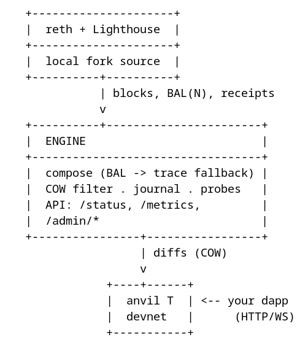

# Mainnet Mirror — local, production-shaped Ethereum mainnet mirror

This repository is the **mirrors workspace**: the Mainnet Mirror (this
section), the [Venue Mirror](#the-venue-mirror-in-the-same-workspace), and the
CCTP bridge between them — one workspace, shared crates, two mirrors that
never share a runtime.

A local Ethereum mainnet **fork source** (`reth` + `Lighthouse`) drives a
**mirror engine** that maintains one Anvil chain:

| Chain | What it is | Written by |
|---|---|---|
| **T** (`anvil-t`) | The devnet: watch-list state kept fresh by applying real EIP-7928 block access lists; your writes live here | engine (diffs) + your dapp |

Consumers connect to **T** (or to reth for the pristine reference within its
10,064-block state window). The engine composes each parent block's writes
from the BAL (with a trace fallback), filters them through the copy-on-write
registry, applies them, verifies with probes and sampled parity, records
every anomaly in `drift.jsonl`, and exposes Prometheus metrics plus an admin API
(fork controls: rewind, pause/resume, clock offset, faucet, shadow marking).
The one accepted limitation is storage proofs (fork blocks report
`stateRoot = 0x0`).

```
   +---------------------+
   |  reth + Lighthouse  |
   +---------------------+
   |  local fork source  |
   +----------+----------+
              | blocks, BAL(N), receipts
              v
   +----------+-----------------------+
   |  ENGINE                          |
   +----------------------------------+
   |  compose (BAL -> trace fallback) |
   |  COW filter . journal . probes   |
   |  API: /status, /metrics,         |
   |  /admin/*                        |
   +----------------+-----------------+
                    | diffs (COW)
                    v
               +----+------+
               |  anvil T  | <-- your dapp
               |  devnet   |      (HTTP/WS)
               +-----------+
```


## The Venue Mirror (in the same workspace)

The same workspace also carries the **Venue Mirror**: a fork-mode Anvil of
HyperEVM (**V**, chain 999, forked from `rpc.hyperliquid.xyz/evm`) driven by
its own engine (`venue-mirror`), with a **simulator** (`venue-sim`) that serves
the venue's API from live market data and a copy-on-write account plane (info
8090, control 8091), and a bridge that mirrors the Core↔EVM boundary. The two
mirrors share the common crates (`anvil` conventions, `devnet` semantics, the
layered config) and never each other. Detail:
[docs/ARCHITECTURE.md](docs/ARCHITECTURE.md#the-venue-mirror).

| | Mainnet Mirror | Venue Mirror |
|---|---|---|
| chain | T (`anvil-t`, an Ethereum fork kept fresh by BAL diffs) | V (`anvil-v`, a HyperEVM fork kept fresh by the poll follow) |
| engine | `mainnet-engine` | `venue-engine` |
| venue plane | — | `venue-sim` (market + account planes, an `hl_mock` superset) |
| admin | deal / shadow / epoch / rewind / probes / pause / resume / time / feed* | deal / shadow / epoch / rewind / probes / pause / resume |
| namespace | `mainnet-mirror` | `venue-mirror` |

**One UX, two parents.** Both mirrors do the same four things — so strategies
and financial workflows can be workshopped against live market data whose
impact is measured 1:1:

1. **Follow the parent 1:1** — T applies real EIP-7928 BALs per block; V
   follows the venue's public API in poll windows (the same composer, the same
   COW filter, the same journal).
2. **Accept your writes** — a key your dapp writes is *devnet-owned* forever
   (copy-on-write): parent diffs never clobber it, and a hand-back
   (`/admin/shadow`) re-syncs it from the source on demand.
3. **Mint liquidity** — `/admin/deal` discovers any ERC-20's balance slot and
   writes it silently; the venue's simulator adds account-level deals, funding
   and liquidations on the same chain.
4. **Measure the divergence** — probes (T vs reth at the applied parent; V vs
   the source at the pin), the sampled/live parity of every applied key, the
   shared drift log (T's apply anomalies, V's follow anomalies) and the
   uncovered-emitter audit turn "did my write behave like the real market
   would?" into counters and facts.

Both proofs run locally against the real engine binaries: `make
mainnet-engine-local` (two anvils; the mainnet side), `make venue-follow-local`
(anvil + the venue engine), `make venue-selftest-local` (against the real
HyperEVM), `make daloc-local` (the whole daloc arc on live market data) and
`make ux-symmetry-local` (both mirrors, the same four verbs, side by side).
The two *workshops* — a strategy run end to end on live state — also run
locally: `make mainnet-workshop-local` (a public-RPC fork of mainnet; minted
liquidity, a real Aave/Uniswap levered position whose pool impact is measured,
live parity, an oracle crash and a liquidation) and `make venue-order-local`
(the daloc stack kept up, then the order lane: fills against the real book
and the §4.5 impact).

## Quickstart

```bash
make ns mainnet-secrets images  # namespace, StorageClass, JWT, pinned images into k3s
make mainnet-bootstrap          # + snapshot download (~50 min, 154 GB) + full stack
make status                     # pods, PVCs, engine status
make mainnet-smoke              # end-to-end checks (parity spot check included)
```

Venue Mirror (a second namespace in the same cluster; no snapshot needed):

```bash
kubectl apply -k k8s/overlays/venue-mirror   # V + venue engine + venue-sim (namespace venue-mirror)
make venue-smoke                             # V, engine, sim and bridge checks
python3 scripts/daloc-sim.py --lane all      # the daloc use-case arc (46 checks; point the
                                             # script's constants at your endpoints first)
```

The local, no-cluster shapes — `make venue-follow-local` (Anvil V + the venue
engine) and `make mainnet-engine-local` (two anvils + the mainnet engine, the
shared UX end to end) — are in [docs/TESTING.md](docs/TESTING.md) → the layer
table.

The bootstrap is ordered on purpose: the reth snapshot lands in the PVC first,
then reth starts, Lighthouse checkpoint-syncs to the CL head, and the anvil
resolves its pin and the engine starts applying.

**Self-contained at runtime.** Nothing outside the namespace is needed once
bootstrapped: reth has **no P2P peers** (`--disable-discovery --trusted-only`)
and gets its chain from the local Lighthouse over the Engine API - including
the snapshot→head gap, which the engine fills with an EIP-8379 top-up loop
(`mirror_source_sync_gap_blocks` falls to 0, ~10-11 blocks/s measured). Blob
custody is the CL's (blob data is not executed; the applier never needs
sidecars). The only external dependencies are bootstrap-time: the reth
snapshot download and Lighthouse's checkpoint sync (both documented in
[ARCHITECTURE](docs/ARCHITECTURE.md#source-liveness-self-contained-by-construction)).

**Freshness check:** `mirror_reth_head` must advance with the chain. While the
top-up catches up, `mirror_source_sync_gap_blocks` counts down; once it is 0,
run `make mainnet-repin` so T starts from a live, exact base. See
[OPERATIONS → Source liveness](docs/OPERATIONS.md#source-liveness-self-contained).

## Common operations

```bash
make logs-reth              # or logs-lighthouse / logs-engine / logs-anvil-t
make mainnet-selftest       # apply 3 real blocks' BALs against a public RPC (no reth needed)
make venue-selftest         # follow real HyperEVM windows against a public RPC (no cluster stack needed)
make mainnet-product-sim    # the margin-product workflow end to end on T (leverage, live data, liquidation)
make mainnet-closure-check  # every market-data view's storage deps must be in the watchlist
make pin-show               # resolved fork pin of T
make mainnet-repin          # re-pin drill: a fresh pin; engine rebases, a new epoch starts
```

Venue Mirror counterparts:

```bash
make venue-smoke         # the venue stack end to end (V, engine, sim, bridge)
make venue-drill         # epoch drill: a write survives a same-pin reset, dies with a new pin
make venue-proof         # capability proof: mint, sim deal, crash⇒liquidation, bridge round-trip
make venue-order-proof   # order-lane proof: fills vs the real book, the §4.5 impact invariants
make cctp-margin-cycle   # crosschain unified-margin cycle: T mint -> CCTP -> venue trade -> CCTP back
make engine-symmetry     # both engines' shared verbs answer identically (fitness function)
```

Engine admin API (controls that belong to the mirror itself):

```bash
kubectl -n mainnet-mirror exec deploy/engine -- curl -s localhost:8080/status | jq
kubectl -n mainnet-mirror exec deploy/engine -- curl -s localhost:8080/metrics
curl -X POST .../admin/rewind -d '{"blocks":5}'      # journal-based rewind of applied parent blocks
curl -X POST .../admin/shadow -d '{"address":"0x..","slots":["0x1"],"account_fields":true}'
curl -X POST .../admin/time -d '{"offset_seconds":2592000}'  # devnet clock 30 days ahead, persistent
curl -X POST .../admin/deal -d '{"token":"0x..","to":"0x..","amount":"1000000"}'  # ERC-20 faucet
curl -X POST .../admin/resume                        # clear a freeze (freeze_m/halt_all runs only)
```

Divergences are **recorded, not fatal**: a fork cannot reproduce
`blockhash(...)` values (Seaport counters are the classic case), so the
applier's sampled parity can legitimately mismatch on such blocks. Every
anomaly is written to `drift.jsonl` and counted in metrics; the next parent
block's absolute writes re-converge the state. The alarm that matters is
`mirror_t_convergence_failures_total` (probes vs reth at the applied parent
block); `verifier.full_sweep` re-reads every applied key for conformance runs.

## Repository layout

```
crates/anvil,devnet,config  common: anvil conventions, devnet semantics, the layered config
crates/mainnet              the Mainnet Mirror project (BAL/trace composer, applier, verifier, feed bridge)
crates/venue                the Venue Mirror project (fork driver, simulator planes, API, Core<->EVM bridge)
crates/cctp                 the CCTP bridge element (Iris-compatible attestation, watcher, relayer, transfer)
bins/mainnet-engine         the Mainnet Mirror engine binary
bins/venue-engine           the Venue Mirror engine binary (fork driver)
bins/venue-sim              the venue simulator (market + account planes; info 8090 / control 8091)
bins/cctp-bridge            the CCTP bridge service (Iris 8095 / control 8096)
k8s/base/mainnet-mirror/    the mainnet base: reth, lighthouse, anvil-t, engine
k8s/base/venue-mirror/      the venue base: anvil-v, engine, sim
k8s/base/cctp-bridge/       the cross-mirror bridge (deploys beside the venue stack; reaches T cross-namespace)
k8s/base/shared/            the mirror-retain StorageClass
k8s/overlays/mainnet-mirror/  single-node k3s overlay (mainnet mirror)
k8s/overlays/venue-mirror/    the venue stack overlay (V, engine, sim, bridge, NodePorts)
k8s/bootstrap/              one-shot Jobs: reth snapshot, CL blob prune, engine selftest, re-pin wipe
scripts/                    lib-mainnet.sh + lib-venue.sh + lib-cctp.sh (the shared plumbing), the
                            mainnet suites (mainnet-smoke, mainnet-scenario, mainnet-proof,
                            mainnet-product-sim, mainnet-closure-check, mainnet-feed-bridge,
                            mainnet-feed-local, mainnet-selftest-local, mainnet-engine-local,
                            mainnet-workshop-local, mainnet-secrets), the
                            venue suites (venue-smoke, venue-drill, venue-proof,
                            venue-order-proof, venue-product-sim, venue-follow-local,
                            venue-selftest-local, venue-order-local, venue-secrets), the cross-mirror suites (cctp-smoke,
                            cctp-roundtrip, cctp-margin-cycle, engine-symmetry), daloc-sim.py
                            with daloc-local.sh (the arc against a local scratch stack), the
                            container proof (container-smoke.sh: the engine image run for
                            real), and the structural fitness scripts (closure-matrix, no-orphans,
                            docs-metrics, trust-audit, clock-labels, no-panics, config-check,
                            docker-members, k8s-wiring, spec-citations, spine-purity,
                            facts-published, metrics-written, render-diagrams)
docs/                       HOW-IT-WORKS.md, ARCHITECTURE.md, SPINE.md, OPERATIONS.md, TESTING.md, adr/
```

## Docs

- **[docs/HOW-IT-WORKS.md](docs/HOW-IT-WORKS.md)** — the short technical
  explainer: architecture, pipelines, information flow, algorithms (the
  Venue Mirror's counterpart: [docs/HOW-IT-WORKS-VENUE.md](docs/HOW-IT-WORKS-VENUE.md)).
- **[docs/ARCHITECTURE.md](docs/ARCHITECTURE.md)** — components, data flow, the
  measured lean profile, design decisions (one Anvil, divergence policy,
  COW, journal), config reference, source
  liveness, and the Venue Mirror (fork driver, simulator, Core↔EVM bridge,
  feed bridge).
- **[docs/SPINE.md](docs/SPINE.md)** — the spine: the information both mirrors
  carry, the interfaces they share, the complete divergence list, the event
  model, and the spec cross-references (EIP-7928/EIP-8379/reth for the
  mainnet; the Hyperliquid docs and live probes for the venue sim).
- **[docs/OPERATIONS.md](docs/OPERATIONS.md)** — signals/thresholds, day-to-day,
  source-liveness playbook, drills, storage/PVC handling, failure playbook,
  venue operations.
- **[docs/TESTING.md](docs/TESTING.md)** — test layers, per-block invariants and
  their classes, the measured facts behind the verifier, the venue smoke, the
  daloc use-case simulation, known limitations.
- **[docs/adr/](docs/adr/README.md)** — the architecture decision records (one
  page each: context, decision, consequences).
