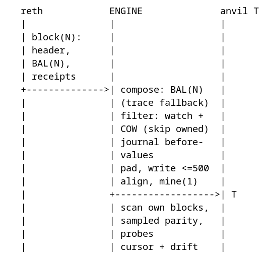
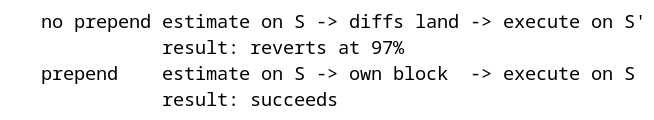

# Architecture

## Components

| Component | Image / build | Role | Measured footprint |
|---|---|---|---|
| `reth` | `ghcr.io/paradigmxyz/reth:v2.8.0` | Source of truth: head state, blocks, receipts, EIP-7928 BALs, `debug` traces | ~300 GB disk, ~2.6 GB RAM idle / ~5.5 GB while following and serving |
| `lighthouse` | `docker.io/sigp/lighthouse:v8.3.0` | Consensus driver: checkpoint sync, drives reth's head via the engine API (no validator), serves payloads + blob sidecars to the engine | ~160 GB disk and growing to ~200 GB (18-day column custody), ~5-7.5 GB RAM while backfilling (16Gi limit) |
| `anvil-m` | `ghcr.io/foundry-rs/foundry:v1.8.6` | Mirror chain (M): replays every parent tx, then re-converges from the BAL | ~15-25 MB per replayed block; OOMs into a fresh pin every ~2.5-4 h by design (24Gi limit) |
| `anvil-t` | same | Devnet chain (T): watch-list state + your writes, never replays parent txs | ~2.5 GB after thousands of applied blocks (16Gi limit) |
| `engine` | `localhost/mainnet-engine:v1` (this repo) | Replay loop, verifier, BAL diff applier, convergence repair, journal, admin API | ~100 MB RAM |

The repo is one cargo workspace (`crates/*` + `bins/*`): `crates/anvil` (the
JSON-RPC client and the measured cheatcode conventions), `crates/config` (the
layered instance loader), `crates/devnet` (the substrate both mirrors share:
shadow registry, journal, cursor state with `epoch_pin`, admin surface,
chain-generic scanner, probes, metrics), the two projects `crates/ethereum`
and `crates/hyperliquid`, and the binaries `bins/{mainnet-engine,venue-engine,
venue-sim,cctp-bridge}` — the fourth is element 3 (`crates/cctp` on the common
client + config only; it does not depend on the devnet substrate or either
project). The projects are siblings - they share the common crates and
never each other; `scripts/closure-matrix.sh` is the structural contract that
enforces it. The table above is the Mainnet Mirror's component set; the Venue
Mirror's components and data flow are in "The Venue Mirror" below.

## Data flow

The per-block exchange between the three processes, top to bottom (the
numbered list below then walks M's side of it step by step):

```
   reth            ENGINE              anvil M / T
   |               |                   |
   | block(N):     |                   |
   | txs, env,     |                   |
   | withdrawals   |                   |
   +-------------->| replay loop       |
   | receipts,     |                   |
   | logs, traces  |                   |
   +-------------->| verify: counts,   |
   |               | gas, bloom, logs  |
   |               | send raws -> mine |
   |               +------------------>| M
   | BAL(N) for    |                   |
   | the watchlist |                   |
   +-------------->| diff applier      |
   |               | pad, write <=500, |
   |               | mine(1)           |
   |               +------------------>| T
   |               | sampled parity,   |
   |               | T probes          |
   +-------------->|<------------------+
   |               | journal + drift   |
```


The exchange above is the ethereum profile's. The venue profile has no parent
stream: V is static between re-pins, and the engine's job is the devnet's own
blocks plus the fork lifecycle ("The Venue Mirror" below), with the
simulator's market and account planes beside it ("The venue simulator").

Per replayed block on M the engine does, in order:

0. **Convergence repair** – apply the parent BAL (`N-1`) to M as cheatcode writes,
   then prove it with the configured probes: `eth_call` on M's repaired (unmined)
   state vs reth at `N-1`. A mismatch here is a real repair failure - not the
   expected blockhash-level noise - so it is the counter to alarm on
   (`mirror_m_convergence_failures_total`, must stay 0).
1. Block env: timestamp, coinbase, prevRandao, gas limit, base fee (all five fields).
2. Withdrawals credited idempotently (`setBalance(pre + amount)`).
3. Raw txs built from the parent block (blob sidecars from the beacon API).
4. Txs sent one request at a time (pool order is load-bearing), then `anvil_mine(1)`.
5. Verification: tx count/order, blob gas, receipts (count/status/gas), logsBloom,
   full log set, withdrawals. (State probes deliberately do *not* re-run here:
   post-execution they only re-detect the blockhash-level divergence the log and
   receipt checks already record - measured on a `BLOCKHASH`-gated MEV bot.)
6. Divergence entry (`drift.jsonl`, only when something diverged) + cursor +
   metrics. Clean blocks are counted in the metrics, never written to disk.

### Devnet transactions: the prepend rule

The applier mines the devnet's pending transactions in **their own block,
before** the parent's diffs are applied (`diff.rs` step 0), then applies the
diffs and mines the parent's block. Two reasons, both measured:

1. **The replayed block must contain only the parent's effects** (plan,
   "Prepend rules"). Without it, a devnet tx and a parent's state change land in
   the same T block and the block no longer means anything.
2. **Gas estimates stay honest.** Anvil estimates the gas for
   `eth_sendTransaction` against `latest`; if the parent's diffs land between
   the estimate and the execution, the tx executes against a different state and
   can run out of gas (measured: an Aave `borrow` estimated at 257,560 used
   271,389 - reverted at 97% of its limit, succeeded with an explicit 1M limit).
   The prepend therefore loops (at most 3 rounds): a tx that arrives *while* the
   diffs are being written still gets its own block and still executes against
   the state its gas was estimated on.

```
   no prepend estimate on S -> diffs land -> execute on S'
              result: reverts at 97%
   prepend    estimate on S -> own block  -> execute on S
              result: succeeds
```


After the parent's block is mined, the applier runs the plan's T-side invariant
("probe parity on T after context alignment"): the same probe set against
T@latest vs reth at the applied parent block. Probes whose target the devnet
owns are skipped (copy-on-write: that state is the devnet's, not mainnet's) and
the check is suspended while a `/admin/time` offset is set (views are then
*meant* to differ). The applier scans its own devnet blocks (the prepend) before
the probes run, so a write made in this very apply is already marked and cannot
fire a spurious alarm. The alarm is `mirror_t_convergence_failures_total`.

T's head therefore drifts ahead of the parent cursor by the number of devnet
blocks (measured: ~70 after a session of drills); that is normal. The cursor stays keyed to the parent height, and the
applier only bails when T's head is *behind* the cursor by more than one block
(an `anvil_reset` outside the engine, which the incremental diff applier cannot
recover from).

### Devnet time: the clock offset (`/admin/time`)

A margin product is a function of time: interest accrual, option expiry, funding
intervals. A static fork gets that from `evm_increaseTime`, but on a live mirror
the next parent block re-aligns the clock and the jump is gone (and worse: the
alignment then fails as non-monotonic, so the block gets anvil's default
timestamp and the context drifts silently - measured).

`POST /admin/time {"offset_seconds": 2592000}` makes the devnet's clock run that
far ahead of mainnet, *persistently*: the applier aligns each parent block to
`parent + offset`, clamped to `last + 1` so timestamps stay monotonic whatever
the offset does. Mainnet's data keeps flowing while the devnet lives 30 days in
the future - measured: the USDC reserve's income index advanced by a month of
interest and a borrow's debt grew with it, with the clock still tracking the
parent. Lowering the offset works; the clock then converges at mainnet's pace
rather than jumping backwards (timestamps cannot). While the offset is non-zero
the T-side probe parity is skipped: time-dependent views are *supposed* to
differ.

### Watchlist closure: proxies need their aggregators

A watched account only stays fresh while mainnet writes to *that* account.
Chainlink feeds are `AggregatorProxy` contracts: `latestRoundData()` is a
delegatecall into the *current aggregator*, whose storage holds the round, so
watching the proxy alone freezes the price at the pin era. The same applies to
Aave oracle sources - they are feeds, and at least the WETH/USD source is itself
a proxy (measured: 8 rounds / ~$44 stale while USDC's direct-aggregator source
stayed fresh and hid the gap). Resolve each source's aggregator and watch it:

```bash
cast call <source> "aggregator()(address)" --rpc-url $RETH
```

**Composite sources need the whole chain.** Aave's WBTC/USD source is not a
feed at all: it multiplies `BTC/USD x WBTC/BTC`, each leg a proxy whose
aggregator holds the round. None of those four contracts was watched, so the
WBTC price on T sat stale (measured: $81,811.77 vs mainnet's $81,810.37 at the
same cursor) while *every* probe stayed green - there was no WBTC price probe.
Found by the product sim's broad freshness audit, which compares the whole
market-data closure per parent block. Heal for this class: trace the source's
read path on reth with the plain `prestateTracer` (no `diffMode` - a view call
changes nothing, so a diff-mode trace is empty), then write the read slots'
values to T. The full price closure now has a probe per reserve, so the class
alarms continuously instead of waiting for an audit.

**Closure runs both ways.** The watchlist must contain every account whose
*mainnet* state the mirror needs, **and** every account the devnet's own writes
land on: a devnet write to an unwatched account is safe (no diff ever touches
it) but *invisible* to `/admin/shadow`, so a reset cannot clear it and a
position keeps a phantom component. Measured: Aave's **variable debt tokens**
were missing, so a reset left `$315` of debt against zero collateral and every
later borrow failed with `LtvValidationFailed`. The full reserve closure is
`getReserveAToken` + `getReserveVariableDebtToken` for each asset.

A watchlist addition only affects *future* writes; a value that went stale
before the entry existed heals on the account's next mainnet write. To heal it
immediately, hand the stale slots back to mainnet sync with
`/admin/shadow {clear: true, slots: [...]}` - the engine re-syncs them from reth
at the cursor (used for the WETH/USD aggregator: hot-vars slot + the
transmission mapping slots, `keccak(roundId, 17)`).

### Fork pins (M refreshes, T persists)

M's fork pin is **re-resolved on every start** (`reth head - FORK_OFFSET`,
64 by default): a full-replay fork is recycled by k8s when it reaches its
memory limit (~2.5-4 h at the measured ~20 MB/replayed block), and a fresh pin
keeps the post-restart re-replay at 128 blocks (~1-2 min) instead of the whole
epoch - a stale pin makes the replay OOM before it can catch up (measured).
T's pin is **re-resolved on every container start** as well (init container +
container wrapper, like M), which bounds the post-restart re-replay to
`FORK_OFFSET` (~128 blocks, minutes) instead of the pin age (~1.5 h measured).
A fresh pin is a **new epoch**: the base moved, and the devnet's recorded
writes are derivations of the old base (plan 2.2/6.3) - restoring them would
mix eras (measured: a +30d time-travel write came back as a future
`lastUpdateTimestamp` and every Aave supply panicked with an underflow). So
the engine clears the shadow registry (marks *and* values) and the product
re-creates its positions from its own journal (plan 3.6); a reset at the
*same* pin restores the recorded writes instead. M's own re-base never touches
T: T's epoch is its own.
Watch `mirror_t_fork_age_blocks` (reth serves reads below T's fork block, and
its state window is 10,064 blocks) and `mirror_t_resets_total`.

## The lean profile (measured, not guessed)

**Snapshot** (`reth download --minimal`): 154 GB download → ~287 GB on disk.
State (266 GB), headers (14 GB), last 50k blocks of transactions (2 GB) +
receipts (1 GB) + changesets (1 GB). Chosen over `--full` (728 GB / 990 GB)
because the mirror only replays *live* blocks.

**Runtime pruning** (`k8s/base/mainnet-mirror/reth-config.yaml`):

| Segment | Retained | Why |
|---|---|---|
| account + storage history | 10,064 blocks | reth's minimum unwind-safe distance; the Anvil pin (`head-128`) lives well inside it |
| receipts | 20,000 blocks | verifier slack + `eth_getLogs` debugging |
| bodies | 20,000 blocks | replayable catch-up backlog after an engine restart |
| senders, tx lookup | pruned | the mirror never serves historical lookups (a pruned lookup is why `eth_getTransactionByHash`/`getTransactionReceipt(hash)` return `null` on reth; `eth_getBlockReceipts` still works) |

**Lighthouse**: checkpoint sync (no genesis sync), no validator, no light-client
server, no QUIC/UPnP, 40 target peers, `--semi-supernode` (half the data
columns = enough to reconstruct any blob within the DA window),
`--prune-payloads=false` (the top-up needs payloads the EL has not executed),
blob/column pruning and backfill rate limiting left at their defaults - all
bounded, see "Backfill limits" below. Measured: the initial sync + state caches
need >6 GiB (it OOM-looped at 6Gi) - the deployment requests 2Gi and limits 16Gi.

**Anvil `--prune-history`** is a memory knob, not a disk knob: it keeps up to N
full *state snapshots* in memory for rollback/tracing. Measured with 1000:
anvil-t reached 9.8 GB in minutes and anvil-m OOM'd at 12Gi. Now: T keeps 32
(its state is small and the devnet uses `evm_snapshot`/`evm_revert`), M keeps 2
(it replays every parent tx, so snapshots are huge and M is recycled by design).
Tracing a historical block on M is therefore limited to the last ~2 replayed
blocks; T's own journal (`/admin/rewind`) is engine-side and unaffected.

**State dumps are disabled** on both chains: `--state`/`--state-interval` wrote
per-block historical state (a T dump grew to 13 GB and never completed; leaked
tmp dirs filled a PVC). Restarts are handled by design instead: a fresh pin
bounds M's re-replay to `FORK_OFFSET` (~1-2 min) and T's devnet writes are
re-applied from the shadow registry.

## Design decisions

**Why two chains.** M replays every parent tx, so its receipts/logs/traces exist
and its execution can be *verified*. T is the devnet: watch-list state is kept
fresh by BAL diffs, your writes live there and are never overwritten. Without M
a divergence would be ambiguous ("engine bug or my scenario?").

**M is executed *and* converged.** A fork cannot reproduce `blockhash(...)`
(A17): Seaport 1.6's `incrementCounter` uses `blockhash(number-1)` as its
quasi-random interval, so its counter (and everything derived from it, e.g.
order validity) diverges on any fork. Because the BAL is the authoritative
post-state of every changed entry, the engine applies the parent BAL to M
*before* each replay. Execution still runs (traces + verification stay real),
but state stays exact: `mirror_m_convergence_failures_total` stays 0 in steady
state. Without this, one Seaport counter divergence cascaded into invalid txs
(queued senders), missing txs, and permanently wrong state within ~10 blocks.

**Blob-tx replay works without any public API.** The local Lighthouse runs
`--semi-supernode`: it custodies half the data columns (enough to reconstruct
any blob) for the 18-day data-availability window, so the engine's only blob
source is `http://lighthouse:5052`. Two measured quirks are handled:

- For Fulu blocks the beacon API's `kzg_proof` field is a *placeholder*
  (`0xc0…`, the point at infinity): the stored container only has cell proofs.
  The engine recomputes the blob proof locally with c-KZG and re-verifies the
  triple. This is a real check, not a bypass - a recomputed proof verifies if
  and only if the blob is the one the commitment commits to, and the tx's
  versioned hash anchors the commitment. Covered by a KZG round-trip unit test.
- A block whose blob txs still cannot be built (source gap) is mined with
  whatever the pool holds after three attempts and recorded; the parent-BAL
  repair keeps M's state exact and T is unaffected.

**Divergence policy: record, don't freeze** (`loops.on_divergence`, default
`continue`). Every divergence is classified and written to `drift.jsonl` +
metrics; `freeze_m`/`halt_all` are for conformance runs. Measured reasons
divergences are inherent:
- blockhash-dependent values (Seaport counters, any `blockhash(n-1)` reader);
- near-full blocks: mainnet block 26,233,028 used 59,975,282 / 60,000,000 gas;
  a small gas delta (type-4 refund accounting is the only *known* systematic
  delta) pushes the last txs out of M's block;
- cascades of the above *within* a block (statuses, log values). Root cause
  measured on block 26,244,417 tx 124: a MEV bot's `BLOCKHASH`-gated entry
  (`revert("ph-")`) succeeds on mainnet and reverts on M; the flipped status
  cascades into WETH supply and Uniswap pool logs, all repaired from the parent
  BAL before the next block.

Structural checks (tx count/order, blob gas, receipt count, withdrawals) are
what an engine bug would break; they are reported separately
(`mirror_divergences_total`) so `continue` stays honest.

**Follow `latest`** (`reth.follow: latest|safe|finalized`). This is a devnet
requirement, not a preference: the applier mines one T block per applied parent
block, so the follow head *is* the devnet's block cadence. With `safe` the CL
updates the safe block once per epoch, the applier burst-mines 32 blocks every
~6.4 min, and a devnet tx sent between bursts waits minutes for a receipt
(measured: 180 s+ timeouts, then "transaction not found" after a pool reset).
With `latest` the parent stream advances every ~12 s and a devnet tx confirms in
~12 s (measured). A small replay margin (`reth.follow_margin_blocks`, default 2)
sits between the head and the applier: the beacon cannot serve blob sidecars for
the newest block yet, and without the margin M held and retried on ~every blob
block (measured: 20 retry errors / 20 min, ~4 blocks/min instead of 5). The cost
is exposure to shallow reorgs; those are detected
(`mirror_reorgs_detected_total`) and M is re-based behind the new head by the
same self-heal path that handles a receding follow head. The mirror follows
*reth's* head: see "Source liveness" below.

**Pins and epochs.** Anvil forks at an absolute pin (`reth head - FORK_OFFSET`,
128 blocks). The pin is re-resolved on every *container* start (the init
container for a fresh pod, the wrapper on a container restart) and persisted in
`/state/pin` as the fallback for when reth is unreachable, so an OOM restart
re-forks at the live head instead of replaying an aging fork until the next
OOM. Reads above the pin come from the replayed chain (M) or from applied diffs
(T); reads below it come from reth's state window (which serves deep history:
10,064 blocks of state, 20,000 blocks of receipts/bodies).

Two constraints bound the pin depth:
1. reth's state window (10,064 blocks ≈ 1.4 days) - reth must be able to serve
   `eth_getProof`/`debug_trace*` reads at the pin;
2. the range of slots the local supernode can reconstruct blobs for (18-day DA
   window, minus anything pruned) - blob txs in the replayed window need
   sidecars.

Depth is a trade-off, not a requirement: 128 keeps the mirror live with a fast,
exact bootstrap (~26 min of replayed mainnet history); raising it replays more
history but costs replay time and M memory. When the pin ages out of reth's
state window, run `make repin`: fresh pins, the engine rebases automatically and
restores the devnet's writes.

**EIP-7702 nonce gaps.** Every authorization in a type-4 tx bumps the
authority's nonce, so a self-sponsored delegation advances the sender's nonce by
2 and blocks legitimately contain nonce gaps (measured: `0x1e6, 0x1e8, 0x1ea`).
Anvil's pool only accepts txs that extend the contiguous pending sequence, so
the engine temporarily moves the sender's nonce to the gap tx's nonce for pool
acceptance and restores the pre-block value before mining (execution then
re-validates in order, with the real auth bumps).

**Copy-on-write (T).** Storage shadows per slot; account fields
(balance+nonce+code) shadow as one unit. The applier skips any parent write
whose key is shadowed, so your writes are never overwritten. Shadowed keys are
discovered by watching T's own blocks: tx sender, value recipients, and storage
writes via `debug_traceTransaction` with `prestateTracer{diffMode}`. Direct
cheatcode calls that bypass T's block pipeline are registered through
`POST /admin/shadow`.

**Fixture ownership (whole-account).** The devnet's fixture deploy writes some
state through cheatcodes the tx scanner cannot see — `anvil_setCode` over the
canonical mock tokens (USDC/WETH/WBTC/DAI) and the seeded Aave aTokens. Those
addresses are listed in the instance's `fixture_addresses` and are
whole-account owned: every parent write to them is skipped without a mark, so
the next mainnet diff cannot clobber a mock. The list is exactly the watched
set that deploy replaces (only watched addresses can be clobbered); it is
config, never persisted, and probes on those targets skip like any
devnet-owned address.

**Journal + rewind.** Before every applied write the applier records the
before-value (`/state/journal/<block>.jsonl`, ring 1024 blocks).
`POST /admin/rewind` restores those values newest-first and moves the cursor
back, so the applier re-applies from there.

**Automine is disabled on both anvils** (`--no-mining`) and the engine
re-asserts `anvil_setAutomine(false)` on every rebase. This is load-bearing:
anvil restarts (re-pin, OOM) reset automine to its default (on), and with
automine on every raw tx mines its own block, so the engine's `mine(1)` produces
empty blocks and the chain height runs away (measured: ~14 blocks mined per
parent block, every block `m=0`, senders' nonces hundreds behind).

**A block that cannot be replayed is skipped, not fatal.** After three failed
attempts the engine mines whatever the pool holds and records the divergence;
the parent-BAL repair still converges M's state, so one block's missing txs
never stalls the mirror. Blob sidecars are fetched from the local Lighthouse
only, validated with the bundled mainnet trusted setup, and placeholder proofs
are recomputed (see above).

**A fresh pin starts a new epoch.** A re-fork at a *changed* fork pin (an OOM
restart or `make repin`) moves T's base, so the devnet's recorded writes -
derivations of the old base (plan 2.2/6.3) - are cleared with it: marks *and*
values go, and the product re-creates its positions from its own journal
(plan 3.6). Measured why restoring is wrong: a +30d time-travel write came
back as a future `lastUpdateTimestamp` and every Aave supply panicked with an
arithmetic underflow. A reset at the *same* pin (an out-of-band `anvil_reset`)
restores the recorded writes instead - the base is identical - and orphan
values (keys handed back earlier) are pruned, never re-owned. `epoch_pin` in
`/state/cursor.json` records the current pin; `mirror_t_resets_total` counts epoch changes.

**Every persisted state file is written atomically** — create the directory,
write a sibling `.tmp`, rename over the target: the shadow registry, the
cursor, the journal's block files, the simulator's account/market state and
the CCTP message store all use the one pattern, so a crash mid-write can never
leave a half-parsed file for the next boot to die on.

**T's heights are its own.** T mines one block per applied parent block, plus
one per journal rewind, so its height is not a mainnet block number - the
engine tracks progress by `cursor_t` (last applied parent block) and only M,
which replays 1:1, is compared against the follow head by height. Two rules
follow from this and both were bugs once: a hash-validated cursor always wins
(resuming at `cursor + 1`, even behind the chain head - jumping to `head + 1`
silently skipped parent blocks and stalled T), and after a reset T resumes from
the fork pin (`pin + 1`), because its state *is* the pin's state.

**The layout is symmetric by construction.** Every layer names the two mirrors
the same way: `crates/ethereum` + `crates/hyperliquid` (the mirror projects —
siblings that never depend on each other), `bins/mainnet-engine` +
`bins/venue-engine` (thin shells, each over its own crate's `main_entry`; the
simulator and the bridge are the venue stack's own services), and
`k8s/base/mainnet-mirror` + `k8s/base/venue-mirror` (service templates, with
the shared cluster-scoped `k8s/base/shared` and one overlay per instance
owning the namespace, the instance ConfigMap and the NodePorts). The instance
files `config/instances/{mainnet-mirror,venue-mirror}.toml` are the single
home of each mirror's wiring, and the Makefile reads one uniform path per
instance (`k8s/base/$(INSTANCE)/engine.yaml`, `$(OVERLAY)/namespace.yaml`) —
no per-mirror conditionals, and no deliberate name difference anywhere: the
binaries are `mainnet-engine` + `venue-engine`, the images match, and the
deployments are both `engine` in their own namespace.

**Measured rules baked into the code** (each cost a real run to discover):
padding all hex to 32 bytes / even length (anvil rejects odd-length hex with
`-32602`); JSON-RPC batches chunked by bytes as well as items (bodies ≥2 MB are
rejected with `-32600`); raw txs sent sequentially (batch items execute
concurrently and scramble pool order); withdrawals credited via `setBalance`
(idempotent - `addBalance` double-credits on retries); type-4 gas delta bound
`[-12,500 × #auths, 0]`; blob sidecars from the beacon API using
`parentBeaconBlockRoot` of EL block N+1; beacon-API quantities are **decimal
strings** while the Engine API wants hex (parsing a decimal slot as hex silently
un-bounds the top-up walk); withdrawal credits read their pre-balance from reth
so a retried block can never double-credit (reading M at N-1 does exactly that,
because anvil's "N-1" is the live state when the block is not mined yet).

**Contracts are as narrow as the body uses.** Every internal seam takes the
narrowest type that carries the fact it needs: leaf helpers take the section
they read (`&Rpc` for a chain client, `&Drift`, `&Plane`, `&EthereumMetrics`,
`&EngineSection`, `&BeaconClient`, `&AtomicBool`/`&AtomicU64` for one flag),
never the whole `Ctx`. A compiler-assisted audit (per-function field-use
analysis over both engines' crates, 2026-10-23) found and narrowed eighteen
leaves: `prepend_devnet_txs` / `fetch_diffs` / `read_before_values` /
`send_once` + `NonceTracker::{prepare, before_send, restore}` / `read_canary` /
`write_canary` / `assert_venue_chain` (`&Rpc`), `log_drift_if_anomalous`
(`&Drift`), `deliver_slot` / `cl_head_el_block` (`&BeaconClient`),
`gap_within_limit` (`&EngineSection`), `account_m_rebase_skip`
(`&EthereumMetrics`), `clear_reapply` (`&Plane`), `hold_replay_failure`
(`&AtomicBool`), `warn_skipped_blob` (`&AtomicU64`). What stays `&Ctx` is a
*composition point*, and the audit names why: `apply_block` / `apply_entry` /
`advance_cursor` / `late_completion` / `finalize` / `journal_and_scan` /
`log_and_drift` thread several sections plus the cursor accessors,
`probes_now` drives `probes_at_pin`, and the blob-form accessors bridge the
preference cell and the persisted state. The payoff is mechanical: a leaf
whose body grows a second dependency cannot compile until its signature says
so, so contracts cannot silently widen. The audit's false positives are the
framework's: axum handlers must take `State<Arc<ApiState>>` (the extractor
dictates the type), and router builders pass the context through to the app.
The same audit's struct pass narrowed fields rather than signatures: both
engines' `Ctx` fields, `Plane.shadow_path` and `Chain.usdc` are `pub(crate)`
(the composition points stay public as types; their fields are crate-internal),
while `Watcher`/`Relayer` keep `pub` fields because the bridge binary
constructs them — the compiler named exactly those two when the pass first
tried them.

## Source liveness: self-contained by construction

At runtime the mirror needs **no external nodes**: no public beacon API, no
public RPC, no EL P2P peers. reth's chain comes from the local Lighthouse over
the Engine API (JWT on 8551):

1. `lighthouse` checkpoint-syncs, then feeds `newPayload`/`forkchoiceUpdated`
   for new blocks to reth as usual.
2. For the gap between the snapshot's head and the CL's checkpoint (measured:
   8.4k blocks ≈ 1.2 days), reth cannot fetch ancestors from peers - it has
   none. The engine's **top-up loop** (`source_sync`, EIP-8379) walks the CL's
   canonical chain from reth's head forward, slot by slot, and feeds each
   ancestor payload to `engine_newPayloadV4` in ascending order followed by
   `engine_forkchoiceUpdatedV3`. reth buffers and executes them contiguously;
   measured ~10-11 blocks/s, so a fresh bootstrap catches up in ~15 minutes.

Spec details that cost real debugging runs:

- **Quantities.** The beacon API serves every quantity as a *decimal string*
  (`"26243147"`, `"1792611803"`); the Engine API wants *hex quantities*. The
  engine normalizes both.
- **`executionRequests`** (EIP-7685 / `engine/prague.md`): each element is
  `request_type || SSZ(request_data)`, ordered by type, and **elements with
  empty request_data MUST be excluded** - all-empty is `[]`, not `["0x","0x","0x"]`.
  reth answers anything else with `-32602 Invalid params: EmptyExecutionRequest`.
  The three request types are re-encoded from the beacon API's structured
  objects (EIP-6110 deposits 192 B, EIP-7002 withdrawals 76 B, EIP-7251
  consolidations 116 B per element; SSZ quantities little-endian).
- **JWT.** alloy's `jwt` feature pulls `jsonwebtoken` without selecting a
  crypto provider, so signing panics at runtime ("Could not automatically
  determine the process-level CryptoProvider"). The engine depends on
  jsonwebtoken with `rust_crypto`; feature unification fixes it graph-wide.
- **A dead top-up task is invisible** (reth simply stops advancing), so the
  loop runs under a supervisor that logs and restarts it on panic/exit.

**Backfill limits** (what each node downloads and keeps, and why). Lighthouse
v8.3.0 has **no backfill-depth flag** - verified against the image itself: the
only backfill-related flags are `--disable-backfill-rate-limiting`,
`--genesis-backfill` (goes *deeper*, never used), `--shutdown-after-sync` and
the pruning knobs. Depth is therefore bounded by design at the weak-subjectivity
point; everything else is a rate/pruning choice:

| Node | Bounded by | Measured / notes |
|---|---|---|
| Lighthouse block backfill depth | weak-subjectivity point (~5 months, ~1.03M slots) | Design bound since v4.2.0; no knob reduces it. One-time: ends with `INFO Historical block download complete` |
| Lighthouse backfill rate | default rate limiter ("typically <20 slots/s") | 6.7-15 slots/s measured; covers the 8.4k-slot snapshot gap in ~10 min, then continues gently in the background |
| Lighthouse block cost | ~150-200 KB/slot | ~150 GB for the full 5-month range; retained in the freezer (blocks are not pruned) |
| Lighthouse column/blob cost | **not bounded to the DA window during the backfill** (measured twice) | The backfill fetches blob/column data for *every* backfilled slot: `blobs_db` grew 13.9-18.6 GB/h (~600-650 KB/slot) at 3-8 slots/s, well past the 18-day window it will ever serve (84 GB at 145k slots covered). Projected peak for the full 5-month range: ~900 GB (blobs) + ~185 GB (blocks). local-path volumes are thin, so this consumes the node's disk (2.4 TB free) rather than a PVC quota; the PVC is sized honestly (1500Gi) and `make prune-blobs` reclaims it |
| Lighthouse prune cadence | `--epochs-per-blob-prune=1` (was 256) | Default 256 epochs (~27 h) can let ~20 GB/h of backfill blobs accumulate before the first prune - more than the PVC headroom. Pruning every epoch bounds the peak; only data older than the DA boundary is touched, which the mirror never needs |
| Lighthouse payloads | retained (`--prune-payloads=false`) | Default pruning rebuilds payloads from the EL on demand - impossible for blocks the EL has not executed, which is exactly the top-up gap. This is what makes the backfilled range cost full block size |
| reth P2P | none (`--disable-discovery --trusted-only`) | 0 peers; no discovery chatter; no pipeline/backfill runs (measured 0 pipeline log lines) - the EL is driven purely by the Engine API |
| reth gap-closing | `--engine.backfill-threshold=1024` (max) | Gaps up to 1024 blocks are closed by fetching blocks directly instead of a *pipeline* run. With no peers both are inert, but a pipeline run can unwind a detached head, so the maximum keeps reth on the live/CL-driven path |
| reth retention | prune profile (see table above) | receipts/bodies 20,000 blocks, account/storage history 10,064 blocks |
| reth bulk download | one-time snapshot, components selected explicitly | `reth download` takes fine-grained flags (`--with-txs-distance`, `--with-receipts-distance`, `--with-state-history-distance`, `--with-senders`, `--with/without-rocksdb`); the job selects the same distances as the runtime prune profile (20k/20k/10,064) instead of the `--minimal` preset, so nothing is downloaded only to be pruned. **RocksDB stays**: it holds the EIP-7928 BAL store the engine reads via `eth_getBlockAccessList`. The state itself (~266 GB) is the floor - 154 GB download / ~287 GB on disk |

Total expected footprint once the one-time backfill completes: ~850 GB of
blobs (mostly beyond the DA window, so prunable) + ~185 GB of blocks in
`lighthouse-data`, and ~300 GB in `reth-data`.

**Reclaiming the backfill's blob storage** - `make prune-blobs` (one-time, after
the backfill logs `INFO Historical block download complete`). It scales the CL
down, runs `lighthouse db prune-blobs` as a Job with the PVC mounted, scales it
back up and prints the new sizes. Stopping the node is required: MDBX is locked
while it runs (measured: `Fatal error: LevelDbError(... lock
/data/beacon/chain_db/LOCK: Resource temporarily unavailable)`). The mirror
survives the pause - reth buffers the CL's payloads and the top-up resumes.
Progress and sizes: `make backfill`.

Pruning removes everything older than the DA boundary - the mirror only ever
needs the replay window (10,064 blocks ≈ 1.4 days, bounded by reth's state
window; the pin itself is only 128 blocks), so this is safe. It leaves ~50 GB of
columns plus the blocks. The alternative trade-off is dropping `--semi-supernode`:
~650 GB less disk, but the mirror loses blob-tx fidelity on M (blob blocks are
mined without their blob txs and recorded; state stays exact via the BAL).

**Follow head during a catch-up.** The engine follows reth's `safe`/`latest` block, which
Lighthouse updates via `forkchoiceUpdated`. While reth is far behind the CL's
head, those updates reference blocks reth has not executed, so reth ignores them
("Received forkchoice updated message when syncing") and its `safe`/`finalized`
pointers stay at the snapshot's values - the mirror's follow head is frozen
until the catch-up completes, then jumps to live. The top-up's own
`forkchoiceUpdated` passes zero hashes for safe/finalized (spec: zero = no
update), so it never clobbers them. After a fresh bootstrap, re-pin once the
catch-up has finished: M/T then start from a live, exact pin instead of
replaying the (partially degraded) catch-up window.

## Pinned versions (tag + digest, no floating references)

Every image reference in the repo is pinned by **full version tag and digest**;
nothing uses `latest`, a minor-only tag, or an unpinned reference. The digest is
verified to be present in the k3s containerd store, so a pod starts with **zero
registry access** (measured: `Container image ... already present on machine`).

| Component | Image | Notes |
|---|---|---|
| reth | `ghcr.io/paradigmxyz/reth:v2.8.0@sha256:796c8664…` | latest release; opens the v2.7 snapshot DB (a manual `reth db migrate-v2` exists, so older layouts stay supported) |
| Lighthouse | `docker.io/sigp/lighthouse:v8.3.0@sha256:ca59d3a3…` | latest release; **v8.3.1 is the standing maintenance item** (the eMudhra CA certificate mitigation — High for stakers, Medium for a non-staking mirror; plan §16.4). Bump via `make images` + the manifest pin when the rollout window allows |
| Foundry (anvil) | `ghcr.io/foundry-rs/foundry:v1.8.6@sha256:4a16a86f…` | latest release |
| init containers / wipe job | `docker.io/library/alpine:3.24.2@sha256:294b683c…` | 3.24.3 exists but the registry was unreachable from this node (DNS/IPv6: `dial tcp [2600:…]: connect: network is unreachable`). Bump with `make images` once it is; the running set is complete without it |
| engine | `localhost/mainnet-engine:v1` | built from this repo; the tag lives in `k8s/base/mainnet-mirror/engine.yaml` and the Makefile reads it from there |

**Single source of truth.** The Makefile derives the image list for `make images`
from the manifests (`grep 'image:' k8s/`), so a version bump is a one-line
manifest edit - there is no second list to drift.

**How to resolve a digest.** Use the client that populates the store (podman /
k3s), not the registry API: for the same tag the API can return a different
manifest depending on the `Accept` header. Measured: Lighthouse v8.3.0 is
`ca59d3a3…` in containerd but `6d76f50b…` via the API. After pinning, verify
with `sudo k3s ctr images ls -q | grep <image>@` - the digest must be listed, or
the pod needs a registry pull (which fails when DNS is flaky, as it was here).

`make images` pre-pulls and imports the pinned references into the k3s containerd
store and then runs **`make check-pins`**, which mechanically enforces the policy:
every `image:` in `k8s/` must carry a tag *and* a digest (or be the local engine
build), the digest must be present in the containerd store, and no `latest` may
appear anywhere. `make bootstrap` runs it first.

The engine's own dependencies are pinned in `Cargo.lock`: the plan's `alloy 2.5`
pin (EIP-7928 BAL types) is deliberate and only patch updates are applied
(measured: `tokio 1.54.0 -> 1.54.1` was the only in-range update). The image
build copies `Cargo.lock` and builds with `--locked`, so the shipped binary
cannot drift from the lock (a stale lock fails the build instead). The build
also prefers IPv4 (`gai.conf`), because this host has no IPv6 route while
crates.io resolves AAAA first. Build bases are pinned the same way
(`rust:1.99.1-slim-trixie`, `debian:13.7-slim`).

The anvil pods read `fork_offset` from the mounted instance file (one anchored
`sed` in their wrappers — the foundry image carries no `mirror-config` binary),
so the offset has one home: the instance file. The legacy YAML ConfigMap
(`engine-config.yaml`) is retired; the wiring env lives in `mirror-config`.

## Engine configuration (`config/`)

The engine reads an **instance TOML** (`/etc/mirror/instance.toml`, mounted
from the instance ConfigMap; `--config` overrides): deployment facts only,
layered over `config/defaults.toml` (the values every deployment shares) with
`${VAR}` references resolved from the pod environment (the L1 wiring in
`mirror-config`) and `MIRROR__SECTION__KEY` env overrides for incidents.
Parsing is strict: an unknown key is a startup error, never a silently ignored
setting (`deny_unknown_fields` on every config struct); a missing required key
or an unresolvable `${VAR}` names itself. `mirror-config check` validates an
instance file (CI + boot gate).

```toml
[instance] { name, namespace, profile }        # profile selects the shape
[chains.l1] { kind = "ethereum", source_url = "${RETH_URL}", follow,
              follow_margin_blocks, fork_offset }   # the offset's single home
[chains.venue] { kind = "hyperliquid", source_url = "${HL_RPC_URL}",
              api_url, ws_url }                    # the venue profile's chain
[services.engine] { state_dir = "${STATE_DIR}", fixture_addresses[] }
[services.engine.anvil] { m_url = "${ANVIL_M_URL}", t_url = "${ANVIL_T_URL}" }
              # ... or v_url = "${ANVIL_V_URL}" (the venue profile)
[services.engine.reth] { request_timeout_secs }
[services.engine.source_sync] { enabled, interval_ms, max_per_pass,
              engine_url = "${ENGINE_API_URL}", jwt_path = "${JWT_PATH}" }
[services.engine.loops] { poll_interval_ms, max_gap_blocks, chunk_size,
              replay_into_m, apply_into_t, repair_m,
              on_divergence = "continue"|"freeze_m"|"halt_all" }
[services.engine.verifier] { enabled, drift_sample_keys, probes[] }
[services.engine.journal] { dir = "${STATE_DIR}/journal", blocks }
[services.engine.blobs] { enabled, beacon_urls = ["${BEACON_URL}"] }
[services.engine.http] { addr, port }
[services.venue_sim] { state_dir, markets, poll_interval_ms, engine_admin_url,
              anvil_url }                # + .info/.control listener sections
[services.cctp_bridge] { state_dir, t_url, v_url, relay_key, attester_seed,
              poll_interval_ms, finality_delay_secs, expiration_blocks,
              scan_chunk_blocks, receipt_timeout_secs, relayer,
              balance_low_wei, balance_critical_wei }   # + .iris/.control
[watchlist] [ { address, note } ]   # all slots of a watched account sync to T
```

**Watch list** (seed = the plan's §3.5 closure): Chainlink feeds (WETH/WBTC/
STETH/USDC/USDT-USD) **and their aggregators**, assets (USDC/USDT/WETH/WBTC/
wstETH), Uniswap Universal Router + WETH/USDC 0.05% pool, Aave V3 (Pool,
Oracle, PoolAddressesProvider, aEthUSDC/aEthWETH/aEthUSDT, WETH Gateway).
Extend with your own deployment addresses. Only watched accounts are synced to
T – add your contracts or their state will stay at pin values.

Closure rule that bit once (measured): a Chainlink feed is an
`AggregatorProxy`; `latestRoundData()` is a **delegatecall** into the current
aggregator, whose storage holds the round. Watching only the proxy left the
price one round stale on T. Resolve the aggregator with `aggregator()`
(selector `0x245a7bfc`) and watch it too; re-check after a feed upgrade, when
the address changes.

**Probes** (per-block `eth_call` parity reth vs M, and reth vs M *after* the
repair): USDC/WETH totalSupply, Chainlink WETH/USD `latestRoundData`, UniV3
`slot0`, aEthUSDC totalSupply, Aave `getReserveNormalizedIncome(USDC)` (the
time-dependence proof – it only matches when the block context is aligned).

## The admin surface (plan §4.4, mapped)

Most of the plan's admin surface is *stock Anvil* - the engine adds only what
Anvil cannot do. This is the mapping, so nothing is ambiguous:

| Plan §4.4 group | Where it lives | Notes |
|---|---|---|
| Network customization | anvil: `evm_increaseTime`, `evm_setNextBlockTimestamp`, `evm_mine`/`anvil_mine` | a devnet override is deliberate and is re-aligned by the next parent block |
| Send | anvil: `eth_sendTransaction` (impersonate first - `anvil_impersonateAccount`, auto-impersonate alone answers "No Signer available"), `eth_createAccessList` | unsigned sends are the devnet's normal path |
| Unlimited faucet | anvil: `anvil_setBalance`/`anvil_addBalance`; **engine: `POST /admin/deal`** (= the plan's §4.4 ERC-20 faucet) | the engine's deal discovers the balance slot with `eth_call` + a `stateDiff` override probe (sentinel value, slots 0..16), writes it silently and marks it devnet-owned. Anvil's own `anvil_dealERC20` cannot do this on a forked, no-mining chain ("no slot found", measured). The plan's synthetic `Transfer` log has no equivalent - use a real transfer |
| Storage / code | anvil: `anvil_setStorageAt`, `anvil_setCode`; engine: `POST /admin/shadow` hands keys back to mainnet sync (immediate: reth's values at the cursor are pushed to T; the engine scans T up to its head first so a just-mined devnet write cannot re-mark the key) | |
| Snapshots | anvil: `evm_snapshot`/`evm_revert`; engine: `POST /admin/rewind` = the plan's §4.4 sync-revert control (rolls T back per parent block through the journal) | |
| Time travel | engine: `POST /admin/time` (persistent clock offset, survives parent blocks) *and* anvil's `evm_increaseTime` (which the next alignment would overwrite - use the offset) | the capability a margin product needs; a static fork's `evm_increaseTime` alone is not enough on a live mirror |
| Mirror sync control | engine: `POST /admin/pause` = the plan's §4.4 stop-sync, `POST /admin/resume` = start-sync, `GET /status` = sync status (`frozen`/`halted` = active, `lag`, `cursor`/`cursor_t` = latest synced block, `follow_head` = parent latest block, `time_offset_seconds` = the `/admin/time` offset) | the plan's sync-next has no counterpart: the loops are continuous, and after a pause the next parent block is applied as soon as you resume |

**Scope vs the plan's fork engine (M1-M5).** This repo implements the plan's
*minimal viable mirror* path - stock Anvil + replay + verifier + BAL diff
applier + journal + the admin surface above - which the plan explicitly allows
to ship first ("the diff applier alone already works on stock Anvil", §4.3).
The custom revm engine (`MirrorDb`, Executor, chain/journal, RPC, native modes)
is **not** built: its purpose is to drop Anvil's per-write cost and get the
modes natively. The watch-list filter makes the stock path viable (1-2 orders
of magnitude fewer writes than a full BAL, which costs 10-50 s/block on Anvil),
and the modes' *capabilities* are provided by the engine's loops + `/admin`
(the mapping table above). If write cost or native modes ever become the
constraint, M1+ is the next step.

The Solidity precompile (M6) and the bridge relay (M7) are future deliverables -
the engine's equivalent today is the HTTP surface above plus the cheatcodes.

## Engine HTTP API

| Endpoint | Purpose |
|---|---|
| `GET /healthz` | 200 unless halted on divergence (an operator *state* signal) |
| `GET /livez` | always 200 — the orchestrator's liveness signal; the k8s probes use this, not `/healthz` (a paused engine must not leave the Service or restart) |
| `GET /status` | heads, cursors, lag, frozen, shadow counts, blob form |
| `GET /metrics` | Prometheus text: heads, lag, durations, divergences (structural + behavioral), repair writes, convergence probes, writes, pin age, the feed bridge's counters |
| `POST /admin/rewind` | `{"blocks": N}` – journal-based rewind of T |
| `POST /admin/resume` | clear a divergence freeze (and a `/admin/pause` halt) |
| `POST /admin/pause` | hold both loops (reads, writes and cheatcodes keep working) |
| `POST /admin/time` | `{"offset_seconds": N}` – the persistent devnet clock offset |
| `POST /admin/shadow` | register devnet writes that bypassed the block pipeline; with `"clear": true` hand the given slots/account fields *back* to mainnet sync and re-sync their values from reth at T's cursor (a key with a stale value and no shadow is the most confusing state there is) |
| `POST /admin/deal` | the unlimited ERC-20 faucet: slot discovery via `eth_call` + a `stateDiff` override, silent write, marked devnet-owned |
| `POST /admin/epoch` | one-call revert-to-blank: re-pin T to the source's latest block; the engine detects the reset on its next pass and runs the epoch rule (new base = clear, same base = restore) |
| `POST /admin/probes` | run the configured probes now (M at the cursor vs reth) and report the run `{ok, failed, skipped}`; the per-block convergence counters stay the loop's. The venue engine's route is the same verb over its at-pin probe set (`make engine-symmetry` checks both) |
| `GET /admin/feed` | the feed bridge's feeds: paused, confirmed/pending answers, decimals |
| `POST /admin/feed/pause\|resume\|override` | pause a feed (the scenario owns its value), hand it back (the next pass re-establishes the source's value), or publish a scripted answer and pause |

## The Venue Mirror

The Venue Mirror serves the same substrate against HyperEVM: **V** (`anvil-v`)
is a fork-mode Anvil of the public chain (`https://rpc.hyperliquid.xyz/evm`,
chain id 999), and a **simulator** serves the venue's own API beside it (next
section). The Mainnet Mirror's machinery does not transfer wholesale, and
deliberately so: HyperEVM cannot be replayed (node-level precompiles, system
txs, dual 1 s/60 s blocks) and the public API exposes no traces, BALs or
proofs, so replay/verify/BAL-diff/prepend/clock-offset are **dropped
permanently** (plan §4.4). What remains is exactly the half both chains share,
delivered by the common crates: the shadow registry (COW), the journal, the
cursor state with `epoch_pin`, the admin surface, the chain-generic scanner,
the probe runner, the epoch rule, and the devnet plane (the registries and
flags as one bundle). The driver in `crates/hyperliquid` is the venue's own
loop.

```
   public HL API (info + WS)         rpc.hyperliquid.xyz/evm
          |                                | fork (pin = source latest)
          v                                v
   +------+-------+                +-------+------+
   |  venue-sim   |  info 8090     |    anvil V   | <-- your dapp
   |  market +    | <------------> |   chain 999  |     (HTTP/WS on 8545)
   |  account     |  control 8091  |              |
   |  planes      |                +-------+------+
   +------+-------+                        ^
          | bridge scan                    | driver: canary,
          +--------------------------------+ epoch rule, probes
                          |
                   +------+-------+
                   | venue-mirror |  /status /metrics /admin/*
                   +--------------+
```

**Two engine binaries, not one profile flag.** The plan sketched one engine
binary with `profile: ethereum | hyperliquid`; the implementation ships
per-profile binaries - `bins/mainnet-engine` (ethereum) and `bins/venue-engine`
(venue) - over sibling project crates, plus `bins/venue-sim`. The reason is
build isolation, and it is a fitness function, not a convention:
`scripts/closure-matrix.sh` declares the allowed internal edges
(`venue-engine -> mirror-hyperliquid + devnet + anvil + config`, no ethereum
edge; `venue-sim` likewise) and fails any undeclared dependency. With one
package every build compiled the whole graph (measured, plan §11.3); a
profile-routing binary would link both projects into every venue build.

**The structural fitness functions.** `make fitness` runs the gates the
doctrine makes checkable, each a script in `scripts/`: `lint` (clippy at the
committed 50-line / 5-arg ratchet), `design-assertions` (`is_normal` over every
public type), `closure-matrix` (the dependency law above), `no-orphans` (no
`utils`/`common`/`helpers` homes), `docs-metrics` (every metric the docs name
exists in the code), `trust-audit` (every `// TRUST:` names its guard),
`clock-labels` (every logged block label appears in its crate's `//! Clocks:`
ledger), `no-panics` (the production code carries exactly two panic-family
sites, both named invariants in the script's allow-list — a service that panics
on an upstream answer is a crash loop, not a degradation) and `config-check`
(every instance file through the layered loader). Each fails on drift; adding a
gate is adding a script and one Makefile line.

**Boot asserts.** The engine waits for V (a coordinated restart must not become
CrashLoopBackOff), asserts the chain id is 999 (a profile over the wrong chain
must not serve), and re-asserts `anvil_setAutomine(false)` - an Anvil restart
resets automine to its default *on* (measured), so the discipline is re-asserted
on every boot and after every reset.

**The chain-instance canary.** V is a fork-mode Anvil, so the ethereum profile's
reset detection (the cursor's block hash) is unsound here: heights below the
fork resolve to the *source's* real blocks, so a re-pin to a later base keeps
every cursor hash valid (measured live: the driver kept scanning a stale range),
and a same-pin restart leaves no trace at all. The driver instead writes one
storage word - address `0x…ca11ca11`, slot 0 - with the current pin as its
value, and reads it once per pass: "the canary reads back the recorded pin"
means "this is still the chain instance the registry was built against". A
fresh fork cannot carry the canary (empty = reset).

**The epoch rule.** A canary mismatch triggers `reconcile`: read V's fork pin
from `anvil_nodeInfo`, then decide, fail-closed on the pin read (without it the
decision would default to "same pin" and re-apply writes across a pin change).
The rule is one implementation for both engines
(`mirror_devnet::epoch::reconcile`, over the devnet plane):

| Situation | Action |
|---|---|
| canary == pin | steady state, nothing to reconcile |
| pin != `epoch_pin` | **new epoch**: drop marks *and* values (`venue_epochs_total`, WARN); the devnet re-creates its state from its own journal |
| pin == `epoch_pin` | **restore**: re-apply the recorded writes, keep the marks; orphan values (keys handed back earlier) are pruned, never re-owned |
| unknown `epoch_pin`, non-empty registry | **new epoch** (fail-closed): the rule must not restore across a base it cannot prove |
| unknown `epoch_pin`, empty registry | not a transition (a fresh state dir): the pin is merely anchored |

Either way the journal is cleared (before-values of the old chain), the cursor
is anchored at the pin (V's state *is* the source's state at the pin), and the
canary is rewritten. The transition is persisted *before* the pin moves: a
crash between the decision and the save must not leave the stale registry on
disk beside an advanced `epoch_pin` (the next boot would read the canary as
matching and keep it). Both engines anchor the pin *before any writes exist*
(T explicitly at boot; V through its boot-time reconcile), so a later
same-pin restart is a provable restore rather than an unprovable epoch — the
fail-closed clear is reserved for real state loss. Why clearing is the
correct default: measured on T, restoring across a moved base re-applied a
+30d time-travel write as a future `lastUpdateTimestamp` and every Aave
supply panicked with an arithmetic underflow.

**Probes-at-pin.** The at-pin probes compare V against the fork source at the
pin, devnet-owned targets skipped and counted (COW: that state is the devnet's).
They run at boot and after every reset - but only while the pin *is* the
source's head: the public source serves its *latest* state for `eth_call`
(measured: V's fork at block N differs from the source's answer at N, while V's
state IS the source's state at N - the block parameter is ignored, or the
retention window is shorter than a re-pin interval). An older pin is skipped
and counted, never alarmed - a mismatch there would be a lie; and a source that
advances mid-run turns the run into "skipped" (a race, not a divergence).
The skip set includes the instance's **`fixture_addresses`** — the canonical
addresses daloc's fixture deploy replaces on V via `anvil_setCode` (their
chain-999 installs: USDC, WETH, WBTC, DAI, WHYPE, wstHYPE): cheatcode writes
are invisible to the tx scanner, so without the list a re-pin-to-`latest`
after their deploy would run the USDC probe against a mock and alarm on a
lie. The list is instance data; empty it for a clean-chain run and the probe
checks again.

**The steady-state scan.** V's head only advances when someone mines (automine
is off), so the driver scans the devnet's own blocks into the shared shadow
registry - every sender's account fields, value recipients, and storage writes
via `prestateTracer{diffMode}` - so `/admin/shadow {clear}` can restore the
source's truth and probes can skip what the devnet owns. The watermark starts
from the persisted cursor, so blocks mined while the driver was down are
scanned too.

**The unshadow source.** `VenueSource` re-syncs a handed-back key from the fork
source *at the pin*, and is fail-closed: the source's `eth_call` serves its
latest state, so a read is only exact while the source's head is still the pin;
once the source has advanced the read is refused with the numbers (pin X, head
Y) rather than silently returning a newer value - "never hand back a poisoned
value". The robust path (recording each write's `pre` value at first touch, so
the base truth lives in the registry) lands with the venue's journaling slice.

**The HTTP surface.**

| Route | Purpose |
|---|---|
| `GET /healthz` | 200 unless halted |
| `GET /livez` | always 200 — the orchestrator's liveness signal (the k8s probes use it, not `/healthz`) |
| `GET /status` | `head`, `cursor`, `fork_pin`, `epoch_pin`, `halted`, `shadowed_slots`, `shadowed_accounts`, `shadowed` (the list), `probes`, `source` |
| `GET /metrics` | the `venue_*` set (below) + the shared admin gauges (`mirror_shadowed_slots`, `mirror_halted`, `mirror_frozen`) |
| `POST /admin/deal`, `POST /admin/shadow` | the shared devnet surface, verbatim |
| `POST /admin/rewind` | the engine's own-write journal (the deal faucet's silent storage writes, recorded under the scan cursor); the shared rewind undoes the last N scanned blocks newest-first |
| `POST /admin/pause` / `POST /admin/resume` | hold / release the driver |
| `POST /admin/epoch` | re-pin V to the source's latest block (`anvil_reset` with an explicit forking config - measured: no-params drops the fork); the driver's canary notices on its next pass and runs the epoch rule, so the route never replicates that logic |
| `POST /admin/probes` | run the at-pin probe set now and report the run (the ethereum engine's route is the same verb over its M-vs-reth set) |

**The deliberate asymmetries** (the rest of the surface is shared, verb for
verb — `make engine-symmetry` is the fitness function): `/admin/time` is the
ethereum's (V's clock is native anvil; a route nobody re-aligns would be a
no-op), the `/admin/feed*` routes belong to the L1 feed bridge (the venue's
counterpart is the simulator's control plane), `/status` reports each
engine's own facts around the shared fields (`cursor`, `halted`,
`shadowed*`), and block production differs by chain nature: T's applier mines
one block per applied parent block, V's driver mines a non-empty pool
(`venue_mined_blocks_total`).

| Metric | Meaning |
|---|---|
| `venue_head` / `venue_cursor` | V's head / the last scanned V block |
| `venue_fork_pin` / `venue_pin_age_blocks` | V's fork base / blocks since the first scanned block in this epoch |
| `venue_epochs_total` | times V was found re-forked under the driver (the epoch rule ran) |
| `venue_restore_writes_total` | writes re-applied by same-pin restores |
| `venue_scanned_blocks_total` / `venue_mined_blocks_total` | V blocks the shadow scan walked / V blocks the engine mined (the pool was non-empty — the engine is V's block producer, the counterpart of T's applier) |
| `venue_probe_ok_total` / `venue_probe_failures_total` / `venue_probe_skipped_total` / `venue_probe_last_failed` | the at-pin probes (skipped = a devnet-owned target, or a pin the source cannot serve) |

**Profile-coherent config.** The instance file is the deployment's single home
(`config/instances/{mainnet-mirror,venue-mirror}.toml`, layered over
`config/defaults.toml`). `[services.engine]` is the same key for both profiles -
what differs is the profile's shape: `[services.engine.anvil]` carries
`m_url` + `t_url` for ethereum or `v_url` for the venue (the check requires
exactly the profile's set), and the venue's driver reads the shared
`loops`/`journal`/`verifier` sub-sections, so the cadence, write chunk and
journal ring live there once for both profiles. `profile = "ethereum"` requires
`[chains.l1]` + `[services.engine]` and forbids `[chains.venue]` /
`[services.venue_sim]`; `profile = "venue"` requires `[chains.venue]` +
`[services.engine]` and forbids `[chains.l1]` - the loader prunes the other
profile's chain and the venue's simulator from the defaults before merging
(without that, a venue instance would inherit the ethereum stub and fail
deserialization), and prunes optional services (the simulator, the bridge) when
the instance file does not carry the section. Unknown keys are errors at every
level (`deny_unknown_fields`).

## The venue simulator

`bins/venue-sim` (image `localhost/venue-sim:v1`) is the venue's own half: it
serves the info API daloc reads (8090) and a control API for scenarios (8091),
backed by two planes and a persisted state root. It is a **superset of the
harness's `hl_mock`**: the same info surface and control ergonomics, plus live
market data and computed mechanics.

### The market plane

Two lanes, one cache. **WS-first**: subscriptions to `allMids` and
`activeAssetCtx` (the server must send a message within 60 s, so the client
pings every 30 s; a dropped connection reconnects with exponential backoff
1 s -> 30 s). **A budget-gated REST poller** backfills `metaAndAssetCtxs`,
`spotMeta`, one `l2Book` per configured market, and `allMids` every 5 s; every
call spends from a rolling-60 s meter of the public API's 1200 weight/min
(measured per-endpoint weights: `metaAndAssetCtxs`/`meta`/other info = 20;
`l2Book`/`allMids`/`clearinghouseState` = 2). A call whose weight does not fit
is skipped, never queued, and counted (`venue_sim_budget_skips_total`); the
default 5 s poll of four markets spends ~600 weight/min at the measured
weights (metaAndAssetCtxs + spotMeta at 20, four books + allMids at 2), well
inside the cap. Per-coin staleness gauges
(`venue_sim_stale_ms{coin}`) are the freshness signal, and `/readyz` gates on it
(meta present + every configured market fresher than 30 s; the client's own gate
is ≤6 s).

Scenario overrides compose over the cache: `crash` owns a coin's **mark and
oracle**, `set_funding` the hourly rate, `set_book` the book (a scripted book is
stamped *now* at serve time - it is the scenario's present, not a snapshot). The
composed view is what every read serves - `metaAndAssetCtxs` publishes the same
owned numbers the account plane prices from, so daloc can never read a different
mark than the sim used for margin. Overrides persist to `feed.json`; the live
cache never persists (a stale file would masquerade as fresh data).

### The account plane (COW)

Untouched accounts are not the sim's business: the API layer passes those reads
through to the real venue, verbatim. A **touched** account (dealt funds, seeded,
or credited by the bridge) is simulated and persisted: its state is the sim's,
its figures are computed from live marks, and it survives a restart.

The internal truth is the *inputs* - the perp wallet's raw USDC balance,
positions with entry prices, spot balances - and every served figure is computed
from them, so the identity daloc's client gates on (1e-6) holds by
construction:

```
totalRawUsd   = balance − Σ szi·entryPx
accountValue  = balance + Σ szi·(mark − entryPx) = totalRawUsd + Σ szi·mark
```

(verified exact on the live sample by a wire test; `positionValue` is served
unsigned with the side in `szi`, as the venue does). Seeding preserves
`totalRawUsd` exactly (`balance = totalRawUsd + Σ szi·entryPx`), so the
operator's recall amount round-trips byte-for-byte.

Mechanics (v1): maintenance margin is ½ the initial margin of the tier the
position's notional sits in; funding accrues **pro-rata** on the sim clock at
the venue's hourly rate and the oracle price
(`payment = −szi·oracle·rate·hours`), all-or-nothing per account (a
missing coin's context defers the whole account's accrual - a partially accrued
account would silently lose the skipped positions' funding forever); below
maintenance, positions close at the mark (the full waterfall - partial closes,
the backstop, ADL - is Phase 2). An account with no positions is never "below
maintenance": negative equity alone is a state the venue reports.

**Self-advance** (the plan's §14.8 decision): the evaluation — funding
accrued to now, liquidations checked against current marks, persist-if-dirty —
runs on every account-scoped read *and* on a 1 Hz tick, so daloc's
set-and-read tests see live funding and liquidation behavior without ever
calling `advance`; `advance` stays for deterministic scripting (n blocks of
the same evaluation, clock included). The sim has its own clock (wall + offset,
offset 0 until `advance` scripts a jump); the wire's `time` field is the
**served clock** — `max(wall, the sim clock, V's head timestamp)`. The bridge
observes V's head time once per new head (their harness jumps every chain
forward and then reads the venue; a served time that lagged the chain would
fail their freshness gate — measured 2026-10-23: after a +3600 s jump, a
touched account served exactly V's head timestamp). Untouched accounts
pass through to the live venue verbatim, so their `time` is the real venue's
own clock — the COW overlay's split, by design.

### The control API

| Route | Body | Effect |
|---|---|---|
| `POST /control/deal` | `{address, class: spot\|perp, coin?, amount}` | mint venue funds (absolute-additive; the perp class is the enforcement's recall source) |
| `POST /control/advance` | `{seconds?, n?}` | jump the sim clock and run `n` liquidation checks inside it |
| `POST /control/crash` | `{coin, pct?}` | own the coin's mark + oracle (absent = hand back to live) |
| `POST /control/set_book` | `{coin, levels?}` | scripted book, ≤20 levels per side (absent = hand back) |
| `POST /control/set_funding` | `{coin, rate?}` | own the hourly rate (absent = hand back) |
| `POST /control/set_account` | `{address, state}` | hl_mock-compatible seeding (`totalRawUsd` + positions); a **patch** in their shape's field names (`userAbstraction`, `spotBalances`; unnamed fields keep their value) |
| `GET /control/state/{address}` | - | the account's control (fixture) view — the hl_mock-compatible patch shape; an untouched address answers hl_mock's default (mode `disabled`), never a 404 |
| `POST /control/reset` | `{}` | blank the scenario (accounts + overrides), bump the epoch |
| `POST /control/epoch_new` | `{}` | reset + re-pin V through the engine's `/admin/epoch` |

`epoch_new` is the one-call revert-to-blank: the engine call goes **first** (if
the re-pin fails nothing has changed - a 502 means "retry the whole thing"), a
retry after success is idempotent on both sides, and the route refuses (409)
when `engine_admin_url` is not configured - a reset that silently left V on the
old base would be the worst kind of success.

### Persistence and the wire

State files are atomic JSON (write temp, rename): `sim.json` (epoch, clock
offset, the bridge cursor, accounts) and `feed.json` (overrides). A load has
three answers - absent (a fact: start empty), fault, or corrupt (dies at the
load point, path named). Money is `rust_decimal` end to end, serialized as
strings - the identity gate is checked at 1e-6, which f64 arithmetic fails at
the edges. Two measured quirks are pinned by unit tests: `spotMeta`'s
`evm_extra_wei_decimals` is snake_case while the rest of the response is
camelCase, and requests must omit null optionals (the venue rejects
`{"type":"metaAndAssetCtxs","dex":null}` with a 422).

**The type discipline** (the import-vs-own rule, applied): every wire seam
speaks the official crates' types - `alloy_json_rpc`'s envelope (`Request`,
`ResponsePacket`, `ErrorPayload`, `Id`), `alloy_rpc_types_eth`/`-anvil`/
`-trace`/`-txpool` for the JSON-RPC namespaces, `alloy_rpc_types_beacon` +
`alloy_eips` for the CL (`BlockResponse<T>` with a narrow body, `BlobData`),
`alloy_rpc_types_engine` for the engine API, `alloy_consensus`' `TxEip1559` +
`encoded_2718` for the CCTP submitter, and `alloy_sol_types`' `sol!` for the
ERC-20 `Transfer`/`transfer` and the eight CoreWriter action payloads (the
selector, the validating log decoder and the ABI decoders are the macro's).
An upstream wire change lands as a compile error at the seam, never as a
silent mismatch. What stays ours is what no crate defines: the HL info/WS
shapes (complete, unused fields included, each pinned by a test that parses a
trimmed **live sample**), the sim's mechanics, the admin/control HTTP bodies,
the config sections, and the CCTP message codec (a packed custom format).
Newtypes mark the namespaces the compiler can police: `mirror_cctp::chains::Domain`
is ours (Circle publishes no Rust crate) because the message header carries the
source and destination domains *side by side* — a swap is now a type error, and
the raw `u32` survives only at the ABI boundary (`.0` in the `sol!` call) and in
test fixtures that speak wire bytes. Chain ids use alloy's official type
(`alloy_chains::Chain`, aliased `ChainId` because cctp already has a `Chain`);
the measured numeric pins stay `u64` consts and are wrapped at the struct
boundary. The same boundary decides `#[non_exhaustive]`: it marks the *remote*
vocabulary (the venue's info and WS enums, the CoreWriter actions) so a
consumer outside the defining crate must carry a default arm, while our own
taxonomies — errors, config, persisted state — stay exhaustive, because a new
variant there *should* break every match at compile time. Both changes made the compiler walk every site: the control API's
request fields and min-fee map, the persisted record, the watcher's lane check,
and the two `depositForBurn` builders — the silent-mixing class, enumerated.

The measured lesson behind the shape tests: `PerpDex` had never parsed the
live `perpDexs` (the sim serves `[null]`), so a missing camelCase rename sat
undetected - a wire type that only ever *serializes* is unverified until a
sample parses through it. Two edges of the rule, measured: there is **no
official Rust SDK** for either protocol (a registry search finds third-party
Hyperliquid crates and nothing from Circle; their SDKs are TS/Python/Java), so
the wire types stay ours - complete and pinned; and the composition roots
(`Ctx`) stay wide *by nature*: every seam takes the slice it needs
(`scan_to(&plane, &rpc, …)`, `record_scan(&walk, &a, &b)`), so the width never
reaches a contract.

The served info surface: `clearinghouseState`, `spotClearinghouseState`
(`balances`; unified accounts also carry `tokenToAvailableAfterMaintenance` —
the figure daloc's client reconciles: `available + maintenance == the
collateral token's balance`), `userAbstraction`, `openOrders` (empty for a
touched account - the matching lane is Phase 2 and, per the plan's §18.4, not
required for daloc's suite: none of its flows place an order, so the account
plane is complete without `/exchange`), `activeAssetData` (touched accounts) /
`meta`, `metaAndAssetCtxs`, `spotMeta`, `allMids`, `l2Book`, `marginTable`,
`exchangeStatus`, `perpDexs`
(`[null]` - the first dex only until multi-dex lands; an account read scoped to
a non-default dex answers the empty shape, a market read scoped to one is a 400).
Unknown types answer `"unrouted"` (hl_mock's contract).

## The Core↔EVM bridge

`crates/hyperliquid/src/bridge` - V is a fork of the real HyperEVM, so the
boundary *contracts* are real (CoreWriter `0x3333…3333`, the system addresses
`0x20…<tokenIndex>`, HYPE `0x2222…2222`), but HyperCore is not there to act on
them. The bridge is the missing half; it runs inside `venue-sim` (the same
service owns the sim state it writes to) and scans V's blocks one pass per
second.

**EVM→Core.** An ERC20 `Transfer` to a token's system address credits the
*sender's* Core spot balance, decoded from the receipt logs (the docs' exact
rule: EVM→Core is an ERC20 transfer to the system address). The token index is
decoded from the address; the completion direction (a transfer *from* a system
address) is never re-credited; a token without an EVM link is not ours to
credit.

**CoreWriter actions.** A call to `0x3333…3333` carries one action: byte 1 =
encoding version (1), bytes 2-4 = action id (u24 BE), then the action's raw ABI
payload. The decoder handles the docs' own `sendRawAction(bytes)` wrapper
(selector `0x17938e13`) as well as a bare stream, and turns the devnet's paths
into a typed enum: 1 limit order, 6 spot send, 7 USD-class transfer, 9 add API
wallet, 10/11 cancels, 13 sendAsset, 16 set abstraction; unmodeled ids are
counted, malformed streams are counted, never guessed at. Calls are collected
from the callTracer, so **contract-internal calls are seen too** (a contract's
action is attributed to the contract - the calling address is the Core
account); a trace fault degrades to top-level txs only and is counted
(`venue_bridge_trace_faults_total`) - internal calls are missed that block,
never silently dropped. Applied to the sim: USD-class transfer, spot send,
sendAsset (spot→spot — a perp-dex `sendAsset`, a multi-dex move, is refused by
name, Phase 2), API-wallet registration, abstraction mode;
insufficient-balance refusals are counted, not retried; orders/cancels wait for
the matching lane (Phase 2) and are counted by id
(`venue_bridge_actions_total{id}`).

**Core→EVM.** A `sendAsset` naming the token's system address debits the sim and
is completed the way the chain does it: a `transfer(recipient, amount)` call on
the linked ERC20 **from** the system address (V runs auto-impersonate). Amounts
convert Core wei -> EVM wei (`weiDecimals + evmExtraWeiDecimals`; USDC 8 -> 6);
a fractional wei is refused, never truncated (the chain burns sub-wei amounts;
the bridge refuses). The system address is funded once so the pool's balance
check passes (on the real chain system txs pay no gas; on V they do).

**The scan is pin-anchored and per-block atomic.** Blocks at or below the fork
pin are the *source's* real blocks and are never scanned (their transfers are
not the devnet's); a first pass, a re-pin, or a chain reset anchors the cursor
at `head.max(pin)`. Per block: decode -> apply -> advance the cursor -> one
atomic JSON save - the block's effects and the cursor land together, so a crash
mid-block re-scans the block instead of half-applying it (a duplicate credit
would be a silent balance lie). The cursor lives in `sim.json`, so a sim restart
does not lose boundary activity mined meanwhile.

| Metric | Meaning |
|---|---|
| `venue_bridge_credits_total` | EVM→Core credits applied |
| `venue_bridge_completions_total` | Core→EVM completion transfers submitted |
| `venue_bridge_refusals_total` | effects refused (insufficient balance, unrepresentable amount) |
| `venue_bridge_malformed_total` | action streams that did not decode |
| `venue_bridge_trace_faults_total` | blocks whose callTracer failed (internal calls unseen that block) |
| `venue_bridge_actions_total{id}` | decoded CoreWriter actions by id |

## The feed bridge (Phase 0)

`crates/ethereum/src/feed_bridge.rs` - daloc's harness periodically re-publishes
its own mock aggregator answers; in mirror mode **the bridge is the single price
writer** for those mocks (their refresher is off, plan §17.2). The value's
source is the *parent chain's* aggregator for the same feed, read at the follow
head via reth; the write target is the devnet's mock aggregator
(`updateAnswer`).

Each pass reads the source's answer and the target's answer and runs a small
state machine, pure so the pause rule is testable without a chain:

| Step | Condition | Effect |
|---|---|---|
| Confirm | the target holds the pending publish | record it as confirmed |
| WaitPending | a publish is in flight | nothing (the target still holds the *previous* value until the tx mines) |
| SkipUnchanged | the source's answer equals the confirmed value | no tx |
| Publish | the source moved | submit `updateAnswer(answer)` from the configured writer |
| Pause | the target holds neither our confirmed nor our pending value | a scenario wrote it: **pause the feed**, never overwrite a scenario's value |

Decimals are read from both sides at boot; a mismatch (or an unreachable feed)
is a boot fault naming the feed - a silently mis-scaled price would poison every
scenario. Stamping is chain-native by construction: `updateAnswer` records the
block timestamp of the T block that mines the bridge's tx, so feeds are stamped
in the devnet chain's own domain, never in wall time (daloc's
`assert_chain_time_invariant` holds).

| Route | Purpose |
|---|---|
| `GET /admin/feed` | every feed: target, source, paused, confirmed/pending answers, decimals |
| `POST /admin/feed/pause` | the scenario takes the value (divergence detection does the same automatically) |
| `POST /admin/feed/resume` | hand it back: the bridge forgets what it last wrote, so the next pass re-establishes the source's value |
| `POST /admin/feed/override` | publish a scripted answer now and pause - the same net effect as a crash write, driven explicitly |

Metrics: `feed_bridge_updates_total{feed}`, `feed_bridge_pauses_total{feed}`,
`feed_bridge_pass_errors_total` (any pass fault; the feed's `last_error`
names the cause). Config: `[services.engine.feed_bridge]`
(`poll_interval_ms`, `writer`, `feeds[]`); absent means the devnet's own price
writers own the mocks (the pre-mirror arrangement), and a boot with the section
present fails loudly if a feed is unreachable or mis-scaled.
