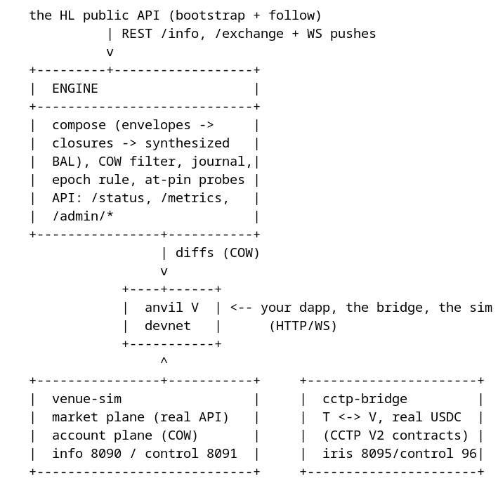
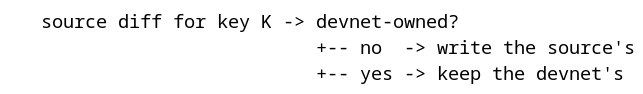

# How the venue mirror works — technical explainer

A short, precise walk-through of the Venue Mirror: architecture, pipelines,
information flow, algorithms. Every number here is measured; operations live in
[OPERATIONS](OPERATIONS.md), component detail in [ARCHITECTURE](ARCHITECTURE.md),
evidence in [TESTING](TESTING.md). (The mainnet mirror — the same machine, a
different parent — is in [HOW-IT-WORKS](HOW-IT-WORKS.md); the shared design in
[SPINE](SPINE.md).)

## 1. What it is

A local, production-shaped mirror of Hyperliquid. The **HL public API** (REST
+ WebSocket) is the parent's read model; a Rust **engine** keeps one Anvil
chain — **V**, chain id 999 — fresh by following the real HyperEVM's windows
and landing their changes per key, copy-on-write. Your transactions live on
**V**, next to live Hyperliquid state; the **simulator** (`venue-sim`) is the
venue the client's product reads: a market plane fed by the real API and a
copy-on-write account plane you can fund, crash, and liquidate.

| | V (`anvil-v`) |
|---|---|
| Contents | the parent's *state* (the declared scope's window diffs) + devnet txs |
| Written by | the engine (diffs, deal) + your dapp + the bridge |
| Guarantee | state parity vs the fork source at the pin, except keys the devnet owns |
| Use | development, the client's venue, the strategy workshop |

The parent's read model is the whole story: HyperEVM has no EIP-7928 BALs and
no historical reads, so the composer **synthesizes** a window BAL from the
envelopes (transactions, receipts, system transactions) and the *declared
closures* — the keys the scope says matter. The engine's own selftest proves
that pipeline against the real chain (`make venue-selftest`).

## 2. Topology

```
   the HL public API (bootstrap + follow)
             | REST /info, /exchange + WS pushes
             v
   +---------+------------------+
   |  ENGINE                    |
   +----------------------------+
   |  compose (envelopes ->     |
   |  closures -> synthesized   |
   |  BAL), COW filter, journal,|
   |  epoch rule, at-pin probes |
   |  API: /status, /metrics,   |
   |  /admin/*                  |
   +----------------+-----------+
                    | diffs (COW)
                    v
               +----+------+
               |  anvil V  | <-- your dapp, the bridge, the sim
               |  devnet   |      (HTTP/WS)
               +-----------+
                    ^
   +----------------+-----------+     +----------------------+
   |  venue-sim                 |     |  cctp-bridge         |
   |  market plane (real API)   |     |  T <-> V, real USDC  |
   |  account plane (COW)       |     |  (CCTP V2 contracts) |
   |  info 8090 / control 8091  |     |  iris 8095/control 96|
   +----------------------------+     +----------------------+
```


One namespace (`diorama-venue`); the CCTP bridge burns on T, which lives in the
`diorama-mainnet` namespace (the venue namespace has no T of its own). The
engine's only inputs are the HL public API (blocks, receipts, system txs,
state) and V itself.

## 3. Information flow

**HL → mirror.** The engine polls the source's head; each pass composes the
window `(followed, head]`: the blocks' transactions, receipts and *system
transactions* (`eth_getSystemTxsByBlockNumber` — the Core's writes into the
EVM, whose receipts are null). The closures turn the window's touched set into
concrete keys; the source's and V's values for those keys are read at the
window's edges and framed as a BAL.

**Mirror → V.** The changed keys become batched Anvil cheatcode writes under
the COW filter. A window is *not* a block: the source's changes land as
storage/balance/nonce/code writes, and the engine mines V only when its own
pool is non-empty (the bridge's boot txs, the harness's calls) — an idle V
stays static.

**HL → sim.** The simulator's market plane polls the same API (REST snapshots
+ WS pushes: marks, mids, books, spot tokens) and serves it through the venue
API (`/info`); the account plane holds the client accounts, seeded and driven
through `/control`.

**V ↔ Core.** EVM→Core is an ERC-20 transfer to a *system address* (`0x20 ‖
token index`); Core→EVM arrives as a system transaction and a CoreWriter log
(`0x3333…`). The bridge watches both sides, so an EVM transfer credits the
sender's Core balance and a `sendAsset` completes back through the system
address.

## 4. The pipeline (per window)

1. **Guard.** The gap guard bounds one window's width at `max_gap_blocks`
   (300): a gap past it composes the oldest bounded chunk and continues next
   pass — a chunked catch-up, never a latching pause and never a silent
   partial poll (measured: the old latching pause froze V's chain-side state
   ~9.9k blocks behind while the source moved ~60 blocks/min, and only a
   manual re-pin recovered it). A parent-hash continuity mismatch (a source
   reorg) is counted and named.
2. **Compose.** Read the window's envelopes from the source; derive the
   touched set; apply the declared closures to get concrete keys; read source
   and target values; frame the changes as a BAL. Emitters no closure covers
   are counted and named (the audit) — never silent.
3. **COW.** Skip every key the devnet owns (the shadow registry) and every key
   outside the scope.
4. **Land.** Batched cheatcode writes to V (`anvil_setStorageAt` /
   `setBalance` / `setNonce` / `setCode`), padded to 32 bytes.
5. **Measure.** Every applied key is re-read on V and compared against the
   composed value (the live parity: `venue_follow_sampled_total` /
   `venue_follow_sampled_ok_total`). A mismatch is an alarm, not drift.
6. **Cursor.** The follow cursor records the window's head and the source's
   own block hash (the continuity check's anchor).

Block production is V's own: `PoolDrain` mines a non-empty pool once per pass
(the bridge's boot transactions and relay mints land without a harness mine).

## 5. Core algorithms

### 5.1 Copy-on-write shadowing

The same registry as the mainnet's: a key becomes devnet-owned the moment a
devnet transaction (or the bridge, or the deal) writes it. Source windows skip
those keys; the recorded values restore them after a re-fork.

```
   source diff for key K -> devnet-owned?
                            +-- no  -> write the source's
                            +-- yes -> keep the devnet's
```


### 5.2 The declared scope and its closures

Watching an account keeps its *account* state fresh (balance, nonce, code).
Storage needs a **closure**: `fixed` slots per contract, or `topic-mapped`
slots — a log's topic is a mapping key (`keccak(pad(participant) ‖
pad(base_slot))`), which is how Transfer logs yield the participants' balances.
Both declared layouts in the cluster instance were verified live with Anvil's
prestate tracer plus the keccak derivation (USDC is FiatTokenV2_2:
`balanceAndBlacklistStates` at slot 9; WHYPE is WETH9-shaped: slot 3).

The audit is the safety net: a log emitter no closure covers is counted every
window (`venue_poll_uncovered_logs_total`) and named in `drift.jsonl` the
first time it is seen — the declared scope is never silently incomplete.

### 5.3 Fork pins and epochs

V forks the source at an absolute pin (`latest` — the source is archive-deep,
so no offset is needed), re-resolved on every *container* start. The blocks
below the pin are the source's own; V's state at the pin *is* the source's
state there.

### 5.4 Re-fork detection and epochs

V's cursor hashes cannot detect a reset (below a fork's pin, heights resolve
to the source's own blocks — ADR 0002), so the engine stamps a **canary** word
into V's storage (`0x…ca11ca11`, the pin + 1) and re-reads it every pass: the
word gone or foreign means the chain instance changed. A *changed* pin is a
new epoch — the registry's marks and values are derivations of the old base,
so they are cleared; the same pin restores the recorded writes. Either way the
journal is dropped and the canary re-stamped. The rule itself is shared with
the mainnet engine (`diorama_devnet::epoch`).

### 5.5 Reorg and gap guard

The source's continuity is checked against the recorded parent hash
(`venue_source_reorg_total`); the window is recomposed from latest, so the
applied keys are canonical — keys only the orphaned blocks touched may be
stale until a later window touches them, which is why the counter is an
alarm. The gap guard bounds a too-wide window's width (see 4.1): bounded
windows compose until the cursor reaches the source head, so the follow
converges on the live source instead of latching paused.

### 5.6 The devnet clock

V's clock is Anvil's own — the engine never re-aligns it, and `/admin/time` is
absent by design: the harness calls `anvil_setNextBlockTimestamp` /
`evm_mine` directly. The simulator serves the venue's time: an account the
sim has touched is served `max(wall, the sim's clock, V's head time)` — never
behind any of the three, so a scripted `advance` jump dominates until
`/control/reset` (which blanks the scenario *and* the clock offset; an epoch
re-pin restores the chain's side); untouched accounts keep the venue's own
clock.

### 5.7 Faucet

`POST /admin/deal` finds any ERC-20's balance slot by probing candidates with
`eth_call` + a `stateDiff` override (sentinel value, slots 0..16), writes it
silently, and marks it devnet-owned. The simulator's `POST /control/deal`
funds its own accounts (perp margin, spot balances).

### 5.8 Journal and rewind

V's journal holds the engine's *own* writes (the deal faucet's silent storage
writes), keyed by the devnet's coordinate — the scan cursor. `POST
/admin/rewind {"blocks": N}` undoes them newest-first; the follow's source
windows are not journaled (a rewind restores devnet writes, never source
history), so the devnet re-creates its own state and the range marker clears
once the head passes it. There is no `rewind` subcommand: the mainnet's exists
for parent before-values, which V's journal never holds.

### 5.9 The simulator

`venue-sim` serves the venue API the client's product reads: the market plane
(live marks, mids, books, spot tokens; staleness gated at 30 s, `/readyz`
covers the meta, the spot registry and the books), the account plane (the
persisted registry; `/info` views computed from it, `/control` for scenarios).
The 1 Hz tick accrues funding and runs the liquidation waterfall: an account
below its maintenance requirement is **first attempted through the book**
(full size, or 20 % per attempt above $100k with the 30 s full-size cooldown);
what the book cannot act on escalates — the vault below ⅔ of the requirement,
ADL for a still-negative value (the opposite side closed at the previous
mark). An account with no positions is never "below maintenance".

### 5.10 The bridge

The CoreWriter path is encoded exactly: the action payload, the system
addresses (`0x20 ‖ token index` big-endian in the remaining 19 bytes; HYPE's
is `0x2222…2222`), and the `Received` event. Measured caveats are in
[ARCHITECTURE](ARCHITECTURE.md): the real USDC blacklists token 0's system
address, so the faithful EVM→Core path uses a token that permits it (PURR on
the cluster proof).

## 6. State and durability

| Where | Holds | Survival |
|---|---|---|
| `engine-state` | cursor, `shadow.json` (marks + values), journal, `drift.jsonl` | Retain |
| `anvil-v` | the fork RPC cache, the pin, the canary | Retain |
| `sim-state` | the account registry, market overrides, the scripted book | Retain |
| `cctp-state` | the bridge's watcher cursors and relayed-message store | Retain |

StorageClass `diorama-retain`: deleting the namespace never deletes data. The
engine resumes from its cursor and the follow cursor; V restores its devnet
state from the registry; the simulator resumes its accounts.

## 7. Alarms that matter

| Metric | Meaning |
|---|---|
| `venue_follow_sampled_ok_total` below `venue_follow_sampled_total` | an applied key did not read back the composed value |
| `venue_source_reorg_total` rising | source continuity changed under the follow — recompose and re-pin |
| `venue_follow_gap_catchups_total` rising | the source ran ahead of one bounded window: the follow composes bounded windows until current (self-healing; a re-pin stays the operator's choice for a fresh base) |
| `venue_poll_uncovered_logs_total` rising | logs from contracts no closure covers: declare a closure to follow them |
| `venue_probe_failures_total` > 0 | V diverged from the source at the pin on a probe |
| `venue_sim_stale_ms{coin}` > 30 s | the market plane is stale — `/readyz` fails |

Full reference and playbook: [OPERATIONS](OPERATIONS.md).

## 8. Known limits (measured, accepted)

- **The source serves its latest state only**: `eth_call` ignores the block
  parameter (measured), so the at-pin probes are meaningful only while the pin
  *is* the source's head — an older pin is skipped and counted, never alarmed.
- **No historical reads**: the follow composes from the window's envelopes and
  the declared closures; an undeclared dependency is *counted* (the audit),
  never silently followed.
- **Fork blocks report `stateRoot = 0x0`**; contracts that verify Merkle
  proofs need the harness's mock.
- **The real USDC blacklists token 0's system address** (measured live), so
  EVM→Core USDC is not a plain transfer; the bridge's proof uses PURR.
- **A thin venue's ADL has no counterparties**: the sim names it in the log
  and leaves the position for the next tick (the real ADL ranks the whole
  book's other side).
- Both chains are single-sequencer devnets: no consensus; the engine orders
  blocks.
- **The spot plane is the ledger, not an order book**: the venue's spot side
  is served as balances (`spotClearinghouseState`) moved by CoreWriter
  USD-class transfers — both directions measured (spot→perp, and the perp→spot
  reverse leaves 8-dec dust) — while spot *order* trading is unimplemented by
  design: the market plane (the real book, funding, the waterfall) is
  perps-only.
