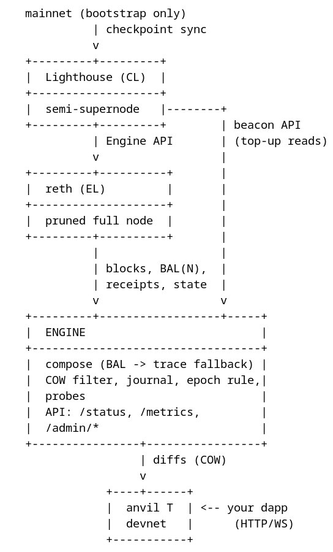
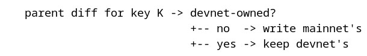

# How the mainnet mirror works — technical explainer

A short, precise walk-through: architecture, pipelines, information flow,
algorithms. Every number here is measured; operations live in
[OPERATIONS](OPERATIONS.md), component detail in [ARCHITECTURE](ARCHITECTURE.md),
evidence in [TESTING](TESTING.md).

## 1. What it is

A local, production-shaped mirror of Ethereum mainnet. A local `reth` +
`Lighthouse` pair follow the real chain; a Rust **engine** keeps one Anvil
chain fresh by applying the real EIP-7928 block access lists — per key,
copy-on-write. Your transactions live on **T**, next to live mainnet state.
(This page is the mainnet mirror's walk-through; the Venue Mirror — the same
machine, its own chain **V** — is in
[HOW-IT-WORKS-VENUE](HOW-IT-WORKS-VENUE.md), the shared design in
[SPINE](SPINE.md).) At runtime nothing outside the namespace is needed: reth
has no P2P peers and is fed by the local Lighthouse over the Engine API.

| | T (`anvil-t`) |
|---|---|
| Contents | the parent's *state* (watch-list BAL diffs) + devnet txs |
| Written by | the engine (diffs) + your dapp |
| Guarantee | state parity vs reth at the applied parent, except keys you own |
| Use | development, your product |

The BAL is the authoritative post-state of every changed entry (reth rejects a
block whose BAL mismatches execution), so applying it *is* state
reconstruction — the spec's own "executionless state updates" use case.

## 2. Topology

```
   mainnet (bootstrap only)
             | checkpoint sync
             v
   +---------+---------+
   |  Lighthouse (CL)  |
   +-------------------+
   |  semi-supernode   |--------+
   +---------+---------+        | beacon API
             | Engine API       | (top-up reads)
             v                  |
   +---------+----------+       |
   |  reth (EL)         |       |
   +--------------------+       |
   |  pruned full node  |       |
   +---------+----------+       |
             |                  |
             | blocks, BAL(N),  |
             | receipts, state  |
             v                  v
   +---------+------------------+-----+
   |  ENGINE                          |
   +----------------------------------+
   |  compose (BAL -> trace fallback) |
   |  COW filter, journal, epoch rule,|
   |  probes                          |
   |  API: /status, /metrics,         |
   |  /admin/*                        |
   +----------------+-----------------+
                    | diffs (COW)
                    v
               +----+------+
               |  anvil T  | <-- your dapp
               |  devnet   |      (HTTP/WS)
               +-----------+
```


One namespace (`diorama-mainnet`). The engine never talks P2P; its only inputs
are reth (blocks, state, BALs, traces) and the beacon API (top-up reads).

## 3. Information flow

**Mainnet → mirror.** Lighthouse follows the chain (checkpoint sync + backfill)
and feeds reth over the authenticated Engine API. Per block the engine pulls
from reth: the block header, `eth_getBlockAccessList(n)` (the prestateTracer
diff when a block has none), and state at historical blocks for probes and
diffs.

**Mirror → T.** The parent's BAL entries for watched accounts become batched
Anvil cheatcode writes; the block context is aligned; the parent's block is
mined. Devnet transactions are mined in their own block *before* the diffs
(the prepend rule).

**Devnet → registry.** A shadow scanner watches T's blocks: every key your
transactions wrote is marked *devnet-owned* (copy-on-write) and its latest
value is stored durably — that registry is what restores your state when T
re-forks.

## 4. The pipeline (per parent block `n`)

0. **Prepend (bounded, ≤3 rounds).** Mine pending devnet transactions in their
   own block(s), timestamp `last + 1`, before the diffs — so the applied block
   carries only the parent's effects, and a transaction executes against the
   same state its gas was estimated on (measured: a borrow estimated pre-diff
   reverted at 97% of its limit).
1. **Compose.** Fetch `BAL(n)` from reth, flatten it to the write set (last
   change per key — the spec's ordering). No BAL: the prestateTracer diff.
2. **Skip devnet-owned keys** — copy-on-write: your state is not mainnet's.
3. **Pad** every slot and value to 32 bytes (anvil rejects anything else).
4. **Journal** before-values per block (ring; what `/admin/rewind` restores).
5. **Write** in batches ≤500: `anvil_setStorageAt` / `setBalance` / `setNonce` /
   `setCode`.
6. **Align the context** — timestamp `max(parent + time_offset, last + 1)`,
   coinbase, prevRandao, gas limit, base fee. Time-dependent views (Aave's
   indexes) only match mainnet with the parent's clock.
7. **Mine.** `anvil_mine(1)` — the parent's block on T.
8. **Scan** T's own blocks into the shadow registry (the prepend's txs
   included), so the next filter sees your writes.
9. **Parity.** 8 sampled storage keys vs reth at `n` (every applied key with
   `verifier.sweep = "full"`), then the 11 probes: T@latest vs reth at `n`.
   Devnet-owned targets are skipped (counted in `diorama_t_probe_skipped_total`
   - a devnet write to a shared contract hides all of that contract's probes
   until it is handed back), and the applier scans its own prepend blocks
   first, so a write made in this very apply is already marked and cannot fire
   a spurious alarm. Suspended while a `/admin/time` offset is set.
10. **Cursor.** Keyed to the parent height; carries the T block's hash for
    re-fork detection.

## 5. Core algorithms

### 5.1 Copy-on-write shadowing

A key becomes devnet-owned the moment a devnet transaction writes it. The
registry (`shadow.json`) keeps the **marks** (source diffs skip those keys
forever) and the **latest values** (state is rebuilt from them after a re-fork).

```
   parent diff for key K -> devnet-owned?
                            +-- no  -> write mainnet's
                            +-- yes -> keep devnet's
```


Unshadowing (`/admin/shadow`) clears both and *immediately* pushes reth's values
at the cursor back to T; the engine scans T up to its head first, so a
just-mined write cannot re-mark the key (the poisoned-source race).

### 5.2 Watchlist closure

Everything whose mainnet state matters must be watched — and watching a *proxy*
is not enough: Chainlink feeds delegate to their current aggregator, Aave's
WBTC source is *composite* (`BTC/USD × WBTC/BTC`), and the wstETH source reads
stETH's share rate. `make mainnet-closure-check` traces every market-data view's storage
reads on reth and flags unwatched dependencies. A watchlist addition only
affects *future* writes; heal a gap by writing reth's values for the slots the
view reads.

**The strategy surface is the watchlist** (measured): the WETH/USDC 0.05%
pool's `slot0` on T is identical to reth's at the applied parent, while an
*unwatched* pool (WETH/USDC 0.3%) still equals reth's value at the fork pin
after mainnet has moved — a trade there prices off the pin, not the market.
Execute on watched venues; the closure check keeps every view the product
reads inside them.

### 5.3 Fork pins and re-basing

The anvil forks reth at `reth_head − FORK_OFFSET` (128), re-resolved on every
*container* start — a restart re-forks at the live head and re-applies only the
pin window. The blocks between the old cursor and a new pin are mainnet's own —
the state is exact by construction.

### 5.4 Re-fork detection and epochs

T's cursor carries the hash of its block at the cursor height; a mismatch means
the chain was re-forked (restart, re-pin). A *changed* fork pin is a new
epoch: the base moved and the recorded writes are derivations of the old base
(plan 2.2/6.3), so the engine clears the registry - marks *and* values - and
the product re-creates its positions from its own journal (plan 3.6). A reset
at the *same* pin restores the recorded writes (the base is identical); orphan
values are always pruned, never re-owned. The journal is cleared either way.

### 5.5 Reorg and gap guard

A parent-hash continuity check counts upstream reorgs
(`diorama_reorgs_detected_total`); the applier continues on the new branch
(absolute post-value writes self-heal for every key mainnet writes again). The
gap guard pauses when the follow head is more than `max_gap_blocks` (300) ahead
of the cursor — except a just-rebased cursor, which may re-apply its whole pin
window (bounded by reth's 10,064-block state window).

### 5.6 The devnet clock

`POST /admin/time {"offset_seconds": N}` makes T's clock run N seconds ahead,
persistently: each parent block aligns to `parent + offset`, clamped to
`last + 1` so timestamps stay monotonic. This is how a margin product tests
interest, expiry, and funding on live data (measured: +30 days moved Aave's USDC
income index by a month of interest, debt grew with it, mainnet kept flowing).

### 5.7 Faucet

`POST /admin/deal` finds any ERC-20's balance slot by probing candidates with
`eth_call` + a `stateDiff` override (sentinel value, slots 0..16), writes it
silently, and marks it devnet-owned. ETH is `anvil_setBalance`.

### 5.8 Journal and rewind

Every applied parent block records its before-values; `POST /admin/rewind
{"blocks": N}` rolls T back through the journal and re-enters the applier. The
journal is a ring (1024 blocks); older history is not rewindable.

## 6. State and durability

| Where | Holds | Survival |
|---|---|---|
| `reth-data` | the EL database (pruned full, ~300 GB) | Retain |
| `lighthouse-data` | checkpoint sync + backfill (~200 GB) | Retain |
| `engine-state` | cursor, `shadow.json` (marks + values), journal, `drift.jsonl` | Retain |
| `anvil-t` | fork RPC caches, pin | Retain |

StorageClass `diorama-retain`: deleting the namespace never deletes data. The
engine resumes from its cursor; T restores its devnet state from the registry.

## 7. Alarms that matter

| Metric | Meaning |
|---|---|
| `diorama_lag_blocks` > 60 (steady 2–3) | the applier is behind (reth/CL unhealthy, or a stalled apply) |
| `diorama_t_convergence_failures_total` > 0 | T drifted on a key you do not own |
| `diorama_full_sweep_mismatches_total` > 0 | a full-sweep apply mismatch (`verifier.sweep = "full"`) |
| `diorama_reorgs_detected_total` rising | upstream reorg — the applier continues on the new branch |

Full reference and playbook: [OPERATIONS](OPERATIONS.md).

## 8. Known limits (measured, accepted)

- **Storage proofs**: fork blocks report `stateRoot = 0x0`; contracts that
  verify Merkle proofs need the harness's mock.
- **`blockhash()`-dependent values** cannot be reproduced by any fork; they are
  detected as sampled-parity anomalies and re-converged by the next block's
  absolute writes.
- **T re-forks lose transaction history** (state is restored).
- Both chains are single-sequencer devnets: no consensus; the engine orders
  blocks.
