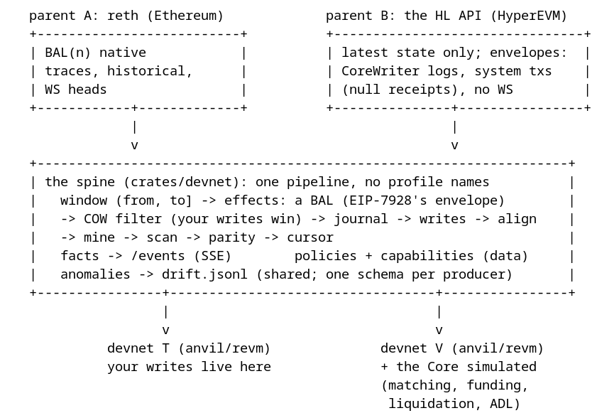

# The spine

One machine, two parents: the information both mirrors carry, the interfaces
they share, the places they diverge, and the evidence for every claim below
(specs, live probes, measured behavior).

## The shape

```
   parent A: reth (Ethereum)             parent B: the HL API (HyperEVM)
   +--------------------------+          +--------------------------------+
   | BAL(n) native            |          | latest state only; envelopes:  |
   | traces, historical,      |          | CoreWriter logs, system txs    |
   | WS heads                 |          | (null receipts), no WS         |
   +------------+-------------+          +---------------+----------------+
                |                                        |
                v                                        v
   +--------------------------------------------------------------------+
   | the spine (crates/devnet): one pipeline, no profile names          |
   |   window (from, to] -> effects: a BAL (EIP-7928's envelope)        |
   |   -> COW filter (your writes win) -> journal -> writes -> align    |
   |   -> mine -> scan -> parity -> cursor                              |
   |   facts -> /events (SSE)        policies + capabilities (data)     |
   +----------------+----------------------------------+----------------+
                    |                                  |
                    v                                  v
             devnet T (anvil/revm)              devnet V (anvil/revm)
             your writes live here              + the Core simulated
                                                (matching, funding,
                                                 liquidation, ADL)
```



## The thesis

A mirror is: **a parent's state changes, replayed onto a devnet chain under
copy-on-write, measured 1:1 against the parent.**

The parent differs — a reth node on Ethereum, the Hyperliquid public API on
HyperEVM — and that one difference, the parent's *read model*, propagates into
exactly the seams listed here. Everything else is one shared pipeline
(`crates/devnet`) and one shared transport (`crates/anvil`).

The EVM is open source, so the mainnet mirror **simulates nothing**: it applies
the parent's own recorded effects (EIP-7928 BALs) to a real EVM (anvil/revm)
and lets the real machine compute the resulting state. Hyperliquid's matching
engine is closed source, so the venue mirror **must** simulate — and it does so
against the published specifications, sentence by sentence (the tables below)
— while its EVM side (V) is again a real EVM, and its Core side is the only
simulated thing in the workspace. That asymmetry is the design: simulate only
what cannot be executed.

## The information spine

Eight things flow, in both mirrors, in this order. Every one of them is a type
in `crates/devnet`; none of them is per-mirror code.

| # | What | The type | What it means |
|---|---|---|---|
| 1 | The window | `bal::Window { from, to }` | The unit of work: `(from, to]` parent blocks. One block on the mainnet (per-block fidelity); a follow window on the venue (the source has no per-block record). |
| 2 | The window's effects | `bal::WindowBal { from, to, kind: DiffKind, bal: BlockAccessList }` | **EIP-7928's structure as the universal diff envelope** (`alloy_eips::eip7928::BlockAccessList`): accounts → `storage_changes`/`storage_reads`, balance/nonce/code changes, each with its `block_access_index`. Native on the mainnet (`DiffKind::Bal`), synthesized on the venue (`DiffKind::Poll`, or `Trace` where traces exist). |
| 3 | The COW filter | `cow::Scope` + `closure::KeyClosure` | The watch set (what the mirror keeps fresh) and the declared closures (what the devnet's own writes own). A key the devnet wrote is skipped, not overwritten: your writes win. |
| 4 | The applier's step | `bal::WindowPlan { kind, total, bal, writes }` | `flatten_bal` → the journal records before-values → the writes land → the context aligns → the block mines → the scanner re-reads → parity → the cursor advances. One transaction per window (`apply_block`'s pipeline). |
| 5 | The measurement | `ProbeSchedule` + the drift log | Mainnet: sampled parity against reth at N, configured probes per block. Venue: live parity against the composed BAL, at-pin probes, the uncovered-emitter audit. |
| 6 | The facts | `facts::Fact` / `Notice` | The event stream (see "The event model"). |
| 7 | The policies | `spine::Policies { clock, mine, probes, prepend_rounds, gap }` | The divergence **as data**: the pipeline reads decisions, never a profile name. |
| 8 | The capabilities | `source::Capabilities` | What the parent can answer: `native_bal`, `traces`, `historical`, `heads_ws`, `system_txs`, `system_tx_receipts`. Declared at boot and audited (`resolve` probes each one). The composer's rung selector reads this. |

## The interfaces

Five traits carry every seam. The projects implement them; `crates/devnet`
never names a mirror.

| Interface | Where | Consumed by | Mainnet impl | Venue impl |
|---|---|---|---|---|
| `Source` | `devnet/src/source.rs` | the composer (reads), the applier (target reads), re-sync/hand-back | reth (historical, BALs, traces, WS heads) | the HL public API (latest-only) + the EVM RPC; `Mirror::follow_source` splits truth reads from follow reads (the pin guard would refuse the follow's reads — reth serves both roles) |
| `Mirror` | `devnet/src/spine.rs` | both engines' assembly | the profile's `Bundle` (label `t`) | the profile's `Bundle` (label `v`) |
| `ResetDetector` | `devnet/src/spine.rs` | the engine's reset pass | `CursorHash` (the cursor's block must carry its recorded hash; below the fork base = stale by position) | `PinCanary` (ADR-0002: heights below a fork's pin resolve to the source, so cursor hashes are unsound there) |
| `KeyClosure` | `devnet/src/closure.rs` | the COW filter | the declared closures (watch-set keys the devnet owns) | same, plus the sim's own writes |
| `Registry` | `devnet/src/metrics.rs` | `/metrics` | one registry per engine, declared series + computed ones | same |

The vocabulary types are the contracts between the traits: `Window`,
`WindowBal`, `WindowPlan`, `Write`, `DiffKind`, `Capabilities`, `Policies`,
`ResetSignal`/`ResetWitness`, `Fact`/`Notice`. A change to any of them is a
change to both mirrors by construction.

**Deliberately not an interface:** the venue simulator. Only one mirror has a
closed-source parent; wrapping the sim behind a trait would invent a second
implementation that cannot exist. Its seam is the `Source` it serves and the
`Fact`s it publishes, nothing else.

## The divergence points

The complete list. Each is a decision, absorbed by an interface (or a policy
field), never by a branch in shared code.

| # | Divergence | Mainnet | Venue | Absorbed by | Evidence |
|---|---|---|---|---|---|
| 1 | Parent read model | reth: historical reads, BALs, traces, WS heads | the HL API: latest-only state ("Ask it for the order book now and you get the book now"), no BAL/traces, **no WS on the EVM RPC** | `Source` + `Capabilities` | Hyperliquid docs (info endpoint; HyperEVM page: "There is currently no websocket JSON-RPC support for the RPC at `rpc.hyperliquid.xyz/evm`"); measured |
| 2 | Effects acquisition | native BAL per block (`eth_getBlockAccessList`; prestateTracer fallback) | synthesized: envelopes (CoreWriter logs, system txs) → touched set → declared closures → reads → `bal_from_writes` | `bal::compose` (rung select from `native_bal`) | EIP-7928 (the BAL structure); reth's `eth_getBlockAccessList`; measured (HL system txs have **null receipts** — the composer decodes `0xa9059cbb` calldata) |
| 3 | Reset signal | cursor hash + fork-base position | the pin canary (a recorded instance word) | `ResetDetector` | ADR-0002; measured (pre-pin hash reads forward to the fork source) |
| 4 | Clock | `AlignToSource` (the applied block's timestamp + the plane's live offset, clamped monotonic) | `Native` (V's own clock; the *product's* clock is the sim's served time policy) | `ClockPolicy` | the venue's own time policy jumps every chain's clock forward; `chain_time = max(wall, head)` |
| 5 | Mining | `PerAppliedBlock` (the parent stream is the devnet's cadence) | `PoolDrain` (an idle chain stays static) | `MinePolicy` | measured (the 2026-10 automine-reset incident) |
| 6 | Prepend | `Some(3)` (a tx arriving mid-apply would be mined against a state its gas was never estimated on) | `None` | `Policies::prepend_rounds` | measured (~5 % short, reverted) |
| 7 | Probes | `PerBlock` (reth can serve the applied block) | `LiveParity` (the source is latest-only; the composed BAL is the expected side) | `ProbeSchedule` | divergence #1 |
| 8 | Gap guard | `Some(max_gap_blocks)` | `Some(max_gap_blocks)` | `Policies::gap` | shared policy, per-instance value |
| 9 | Simulation | none — real EVM, real state | the Core (closed-source matching engine) simulated; the EVM side (V) real | `crates/venue/src/sim` (its own crate folder) | see the cross-reference table |

## The event model

The fact stream is the engines' primary interface to the outside. The rule:
**every state-changing step publishes exactly one fact**; the HTTP surfaces
(`/status`, the state files) and the metrics are *derived* views, and a
consumer that missed events re-reads them instead of replaying. `/events` is
SSE: one JSON notice per event, `id:` = the bus sequence number, the bus keeps
the newest facts only (a lagged subscriber resumes from the oldest retained —
the notification contract, not a log).

| Fact | Published when | Carries |
|---|---|---|
| `BlockApplied` | one diff was composed and applied | the composer's truth (`bal`/`trace`/`poll`/`late`/`reapply`), writes/filtered/skipped/sampled counts, ms |
| `CursorAdvanced` | the devnet cursor moved | block |
| `ResetDetected` | a reset was witnessed | the witness (position / hash / pin) |
| `EpochChanged` | the epoch rule ran | the new pin |
| `ProbesRun` | an on-demand probe run finished | ok/failed/skipped (per-block counters are metrics, not facts) |
| `ShadowScanned` | the COW scan walked blocks | blocks/empty/shadowed |
| `TopUpDelivered` | the top-up loop fed reth payloads (mainnet-only) | count |
| `DealApplied` | an engine's `/admin/deal` wrote a key (the sim service is plane-less by design, so the engine's door is the fact's home) | chain, address |

The sim's own events are the served state (orders, fills, liquidations,
funding) — the venue's *external* contract, because that is what its parent
serves. The two engines share the fact vocabulary; the sim's records are
per-sim types, deliberately (they are wire shapes, not engine events).

## Component specs

Common components (`crates/devnet`, `crates/anvil`, `crates/config`):

| Component | Owns | Must not |
|---|---|---|
| `anvil::Rpc` | the transport: one `Arc<Rpc>` per endpoint, typed reads (`call_decode<C: SolCall>`), measured error recognition (`is_method_not_found`), the cheatcode conventions | know any chain's semantics |
| `devnet::bal` | the window, the rungs, `flatten_bal`, `bal_from_writes`, the plan | read a source directly (it composes through `Source`) |
| `devnet::cow` | the watch set, the declared closures, the skip rule | decide *what* is watched (the mirror's `Scope` does) |
| `devnet::journal` | before-values, one atomic save per window (`store::save_bytes`) | hold business state |
| `devnet::state` | the cursor, `epoch_pin`, the offset, the halted flag | know which chain it tracks (the `chain` tag is data) |
| `devnet::scanner` | the re-read of touched keys, parity | interpret a value (that is `probes`) |
| `devnet::facts` | the bus, sequence numbers, the notification contract | persist anything |
| `devnet::spine` | the seams (traits), `Policies`, `ResetSignal` | name a mirror |
| `config` | the layered loader, `${VAR}` resolution, validation | default a chain behavior |

Profile components, each in its own folder and never importing the other
(`scripts/closure-matrix.sh` enforces the sibling rule):

| Component | Owns | Must not |
|---|---|---|
| `mainnet::profile` | the bundle: reth source, `CursorHash`, the policies, the watch scope | grow a second source |
| `mainnet::feed_bridge` | the beacon/engine wiring (checkpoint sync, the top-up loop) | touch the applier |
| `mainnet::engine_api` | the JWT-authenticated engine transport, `parse_response` | share a type with the venue |
| `venue::profile` | the bundle: the HL sources, `PinCanary`, the policies | read the sim directly (the feed does) |
| `venue::bridge` | the CoreWriter action table, the system-tx completions, the Core↔EVM boundary | interpret an action's economics (the sim does) |
| `venue::feed` | WS-first market data (ADR-0006), REST backfill, the served book | decide margin |
| `venue::sim` | the closed-source semantics: accounts, orders, the waterfall, funding, the served wire | exist behind a shared trait (only one mirror has this) |
| `cctp` | the fourth element: the CCTP lanes + the Iris-compatible attestation API, on the common client + config only | depend on the devnet substrate or either project |

## Where the next divergence happens

The seams above are ranked by blast radius: a new parent kind (or a new
capability on an existing one) lands in this order, and only the first two are
code the pipeline never sees.

| # | Step | What it decides | The failure it prevents |
|---|---|---|---|
| 1 | `Capabilities` | what the parent can answer (`native_bal`, `traces`, `historical`, `heads_ws`, `system_txs`, `system_tx_receipts`) | a declared capability the endpoint does not serve: `verify_methods` audits each at boot (the behavioral two — `historical`, `heads_ws` — cannot be probed; their reads enforce them) |
| 2 | `Source` | the primitives it serves; the trait's defaults compose the rest (`read_key`, `bal`) | a source that has to implement what it cannot serve |
| 3 | `ResetDetector` | the witness the parent admits (a cursor hash if its blocks are stable; a canary if not) | a reset detected by the wrong signal — the venue's heights below a pin resolve to the fork source, so its hashes are unsound (ADR-0002) |
| 4 | `Policies` | clock, mining, probes, prepend, gap | mirroring a cadence or a clock the parent does not have |
| 5 | `Scope` + `KeyClosure` | what stays fresh and what the devnet owns | overwriting the devnet's own writes |
| 6 | `Bundle` | the six fields, filled | — (data, not code) |
| 7 | The composer rung | nothing if the parent serves BALs; otherwise `touched` (envelopes) + the declared closures + the reads | an uncovered emitter (the audit counts them) |
| 8 | A simulator, only if the parent's state cannot be read at all | the closed-source semantics + their spec table (the venue's discipline) | simulating what could be executed |

The classes of divergence this predicts, and where each lands:

- **Latest-only reads** (the HL API's model): the follow/truth split
  (`follow_source`), `ProbeSchedule::LiveParity`, and windows instead of
  per-block work.
- **Reorgs deeper than the fork base**: the reset detector + the epoch rule
  (marks *and* values reconciled) — never a silent re-apply.
- **A parent clock that must not be mirrored**: `ClockPolicy::Native`.
- **A cadence that must not be mirrored**: `MinePolicy::PoolDrain`; one that
  must: `PerAppliedBlock`.
- **A new effect shape** (system txs, blobs, envelope-only events): the
  envelope decoder + the uncovered-emitter audit; the BAL stays the one
  vocabulary (`block_access_index` 0/n/n+1).
- **A rate/operational budget** (the HL EVM RPC's 100 requests/min): the
  follow window and poll cadence are sized to it — an operational constraint,
  never a semantic one.
- **Private, non-deterministic state** (a matching engine): a simulator with
  its own spec cross-reference table — and only then.

What holds for *any* mirror, by construction (the pipeline's contracts): the
devnet's own writes win (COW); one transaction per window (the journal's
before-values and the cursor move together); the epoch rule on a pin change;
parity as the measurement; every step published as one fact.

### Adding a third mirror: the checklist, and the gate that fails until each step is done

The interfaces above are the whole contract; the gates make the steps
mechanical. A third kind (an OP-stack parent, a second venue) is this list, in
order:

| Step | Artifact | The gate that fails until it exists |
|---|---|---|
| 1 | `crates/<name>/src/source.rs` — the `Source` impl; every `Capabilities` flag declared (`resolve` audits each method at boot); a source serving native BALs owes `verify_bal_commitment` on every retrieval (the EIP's header commitment) | `spine-purity` (the crate may not name a mirror; `crates/devnet` may not name it), `no-orphans` |
| 2 | the watch set and the declared closures | `closure-matrix` |
| 3 | `crates/<name>/src/profile.rs` — the `Bundle` data, `Deps`, `build` | `spine-purity` |
| 4 | `bins/<name>-engine` + the compose/Dockerfile members | `docker-members` |
| 5 | the k8s manifests | `k8s-wiring` |
| 6 | the registry's series + the docs' series table | `metrics-written`, `docs-metrics` |
| 7 | the clock policy | `clock-labels` |
| 8 | the config schema | `config-check` |
| 9 | the fact publishes (the vocabulary is shared — nothing to add) | `facts-published` |
| 10 | the spec rows in this file | `spec-citations` |
| 11 | the trust surface (who may call what) | `trust-audit` |
| 12 | small scopes as it grows | `ast-scope` |

The whole-workspace gates (`lint`, `no-panics`, `design-assertions`) apply to
every step. A simulator (step 8 of the ranking table above) is the one step
with no gate: it must not exist unless the parent's state cannot be read at
all — and then it owes its own cross-reference table (the venue's discipline).

## The venue sim, cross-referenced

Every behavior against the sentence it implements (sources: Hyperliquid docs,
fetched 2026-10-24; the probe rows are live API measurements).

| Sim behavior | The spec | Disposition |
|---|---|---|
| Maintenance margin = ½ the initial margin at max leverage (1.25 %–16.7 %) | "The maintenance margin is half of the initial margin at max leverage" | implemented (`maintenance_rate`, margin tiers from the live meta) |
| Book first: market orders for the full size | "the positions are first attempted to be entirely closed by sending market orders to the book" | implemented (`liquidate_via_book`) |
| 20 % per attempt above 100k USDC; 30 s cooldown makes every attempt full-size | "For liquidatable positions larger than 100k USDC, only 20 % … there is a cooldown period of 30 seconds. During this cooldown period, all market liquidation orders for that user will be for the entire position" | implemented (`attempt_size`, per-user cooldown) |
| Below ⅔ of maintenance → the liquidator vault; maintenance not returned | "below 2/3 of the maintenance margin … a backstop liquidation happens through the liquidator vault"; "During backstop liquidation, the maintenance margin is not returned" | implemented (`rescue_step`, `vault_take`) |
| Cross backstop: cross positions + cross margin; isolated: that position + its margin | "the trader's cross positions and cross margin are all transferred"; "that isolated position and isolated margin are transferred … The user's cross margin and positions are untouched" | **fixed this wave** (the waterfall's legs) |
| Isolated positions liquidate on their own inputs | "the only inputs to the computation are the isolated margin and the notional value of the isolated position"; "isolated positions will apply unrealized pnl as additional margin" | **fixed this wave** (`check_account`'s isolated legs) |
| A closed isolated position returns its margin | implied: the margin is the trader's collateral (only the position is gone) | **fixed this wave** (`apply_fill`) |
| Strict isolated: margin cannot be removed; released proportionally on close | "strict isolated … the additional constraint that margin cannot be removed. Margin is proportionally removed as the position is closed" | **fixed this wave** (refused by name; proportional release) |
| Negative account/isolated value → ADL; ranking `(mark/entry)·(notional/account_value)`; closed at the previous mark | "If a user's account value or isolated position value becomes negative … The specific sorting index … is `(mark_price / entry_price) * (notional_position / account_value)`. Those traders' positions are closed at the previous mark price" | implemented (`adl`, `adl_ranking`) — the index and the price match the sentence exactly |
| Liquidation uses the mark price | "Liquidations use the mark price, which combines external CEX prices with Hyperliquid's book state" | implemented (the served mark; the mark's own formula is the venue's) |
| Isolated liq price formula | "`liq_price = price − side · margin_available / position_size / (1 − l · side)`", `margin_available (isolated) = isolated_margin − maintenance_margin_required` | implemented (`liquidation_px`) |
| Tick/lot: prices ≤ 5 significant figures and ≤ `6 − szDecimals` decimals (integers always valid); sizes rounded to `szDecimals` | "Prices can have up to 5 significant figures, but no more than `MAX_DECIMALS - szDecimals` decimal places where `MAX_DECIMALS` is 6 for perps"; "Sizes are rounded to the `szDecimals`" | implemented (`validate_tick_lot`; the perp rule — the sim trades perps) |
| Minimum order value $10 | the exchange page's own error sample: "Order must have minimum value of $10." | implemented verbatim (`validate_min_notional`) |
| Nonces: the 100 highest per signer, larger than the smallest retained, never reused, window (T−2d, T+1d) | "the 100 highest nonces are stored per address. Every new transaction must have nonce larger than the smallest nonce in this set and also never have been used before. Nonces must be within `(T - 2 days, T + 1 day)`" | **fixed this wave** (the floor; the window and reuse were already there) |
| Fast cancels: `f: true` refused for trigger orders; `f: false` must be omitted | "Orders with `f: true` are rejected if they refer to trigger orders"; "`f` must be skipped if false" | **fixed this wave** (the flag rides `cancel`/`cancel_by_cloid`; the omitted-when-false rule was there) |
| Trigger direction: for a buy, a stop's trigger above the mid and a take's below (sell: reverse) | "Stop Market … For long orders, the trigger price needs to be higher than the mid price. For short orders … lower"; "Take Market … lower … higher" | **fixed this wave** (`validate_trigger_side`, the served book's mid) |
| scheduleCancel: ≥ 5 s ahead; max 10 triggers per day, reset 00:00 UTC | "The time must be at least 5 seconds after the current time … The max number of triggers per day is 10. This trigger count is reset at 00:00 UTC." | **fixed this wave** (the cap; the 5 s floor was there) |
| `always_place=false`: the new order must be non-trigger, ALO or a non-executable Gtc (overridden to ALO) | "When `always_place = false` the new order must be a non-trigger order, and must have TIF = ALO or a non-executable order with TIF = GTC. In the latter case, TIF of the new order is overridden to ALO." | implemented (`modify_one`) |
| Funding: hourly, `position_size · oracle_price · funding_rate`, all-or-nothing per account | "Funding is paid every hour"; "the spot oracle price is used to convert the position size to notional value, not the mark price" | implemented (`accrue_funding`) — oracle, hourly, all-or-nothing |
| Funding rate: interest 0.01 %/8 h, premium clamp, 4 %/h cap | the funding page's formula | **not computed**: the sim consumes the venue's own served `activeAssetCtx.funding` (a reimplementation would drift; the venue's figure is the truth) |
| Core↔EVM transfers: system addresses (`0x20` + the token index big-endian; HYPE `0x2222…2`); EVM→Core credits from the linked contract's `Transfer` log; Core→EVM completes as a `transfer(recipient, amount)` from the system address; HYPE is native | "Every token has a system address on the Core, which is the address with first byte `0x20` and the remaining bytes all zeros, except for the token index encoded in big-endian format"; "The tokens are credited by a system transaction that calls `transfer(recipient, amount)` on the linked contract as the system address"; "The EVM transfer address `0x222..2` is a system contract that emits `event Received(address indexed user, uint256 amount)`" | implemented (`system_address`, `transfer_of`/`credit_of` with the linked-contract emitter check — a look-alike event never credits; `hype_received_of` **added this wave**: the `Received` event credits Core HYPE, 18 EVM decimals floored to 8 Core wei, the docs' burn caveat). Measured caveat, documented in the module: the real HyperEVM USDC blacklists token 0's system address, so daloc's deploy uses its own ERC20 mocks — the path the bridge credits |
| Margin checks at placement **and again at match time for the resting side** | "Margin checks happen on the opening of a new order, and again for the resting side at the matching of each order. This ensures that the margining system is consistent despite oracle price fluctuations after the resting order is placed." | implemented (`require_order_margin` at placement; `remargin_makers`/`remargin_one` at match — a maker that cannot carry the fill is canceled, the venue's `marginCanceled`) |
| Self-trade: trades between the same address cancel the resting order instead of filling (expire-maker) — no fee, nothing in the trade feed | "Trades between the same address cancel the resting order instead of causing a fill. No fees are deducted, nor does the the cancel show up in the trade feed." | implemented (`expire_self_crossing`: the crossing order is canceled through the venue's own cancel path, so the terminal history says canceled and no fill exists); **the liquidation's close now expires them too** (`liquidate_position` — it could self-match before; a test cites the sentence on each path) |
| Entry price and pnl: opening trades average into the entry (weighted by size), closing trades keep it, a flip opens the remainder at the fill price; unrealized `side · (mark − entry) · size`; closed pnl = the fee on an open, `fee + side · (mark − entry) · size` on a close | "For opening trades, the entry price is updated to an average of current entry price and trade price weighted by size"; "For closing trades, the entry price is kept the same"; "entry price, unrealized pnl, and closed pnl are purely frontend components … The fundamental accounting is based on margin (balance) and trades." | implemented verbatim (`apply_increase`/`apply_reduction`); the page's own note is the design's too — the served views are conveniences, the state transition is the margin balance |
| TP/SL: the mark triggers them; a market TP/SL carries a 10 % slippage tolerance; position-linked orders default to the whole position (fixed once sized); a parent order's children are placed iff it fully fills (or is margin-canceled) | "The mark price is used to trigger TP/SL orders"; "TP/SL market orders have a slippage tolerance of 10%"; "children TP/SL orders associated with a parent order will be placed if and only if the parent order fully fills or is partially filled followed by a cancelation for insufficient margin" | the mark trigger is implemented (armed triggers fire on the mark's cross; the mid feeds only the direction rule); the grouping's lifecycle is **refused by name** (`normalTpsl`/`positionTpsl` — the portfolio-margin precedent); the 10 % tolerance is the book walk's own — a named simplification |
| The price division of labor: the oracle (a weighted CEX median, ~3 s updates) computes funding; the mark (the median of three inputs, updated with the oracle) "is used for margining, liquidations, triggering TP/SL, and computing unrealized pnl" | the robust-price-indices page | implemented: funding consumes the served rate; the mark feeds the margin checks (the requirement is at the mark), the liquidation trigger, the TP/SL trigger and the served unrealized pnl; the constructions themselves are the venue's — consumed, never recomputed |
| The transfer rule: `transfer_margin_required = max(initial_margin_required, 0.1 * total_position_value)`; "transferring" includes withdrawals, transfer to spot wallet, and isolated margin transfers; "The margin required to open a position is `position_size * mark_price / leverage`" | the margining page (verbatim); the info endpoint's own example pins the flat case (`withdrawable = cross accountValue − totalMarginUsed`, cross side flat) | **fixed this wave**: `withdrawable` is the cross value minus that floor (it served the whole cross value); an isolated margin *removal* must leave the floor in place (`update_isolated_margin`); the order margin reserves at the mark (`available_for`/`reserved_margin` — the placement check, the match-time re-margin and `activeAssetData`'s `availableToTrade` are one figure) |
| Subaccounts and vaults: "Subaccounts and vaults do not have private keys. To perform actions on behalf of a subaccount or vault signing should be done by the master account and the `vaultAddress` field should be set to the address of the subaccount or vault." | the exchange endpoint, "Subaccounts and vaults" | **fixed this wave**: the action's state owner is `vaultAddress` when present, else the signer (`acting_owner`); the nonce stays the signer's (the docs' per-address nonce set) — the prime-broker path |
| The EVM's dual-block cadence: small blocks every 1 s (3 M gas), large blocks every minute (30 M gas), interleaved in one increasing EVM number sequence; the mempool accepts only the next 8 nonces per address | the dual-block-architecture page | the venue's EVM reads are time-shaped and rate-sized (the follow window to the 100 req/min budget), never block-shaped — the cadence is why; the mempool rule constrains senders, not our read-only scan |
| Delisting: "When an asset is delisted, all positions are settled and open orders are cancelled ... After settlement, no new orders will be accepted"; the settlement price is "the 1 hour time weighted spot oracle price" | the delisting page (verbatim) | **fixed this wave**: `settle_delisted` (the tick's pass: orders cancelled, positions closed at the served oracle — a named simplification of the TWAP; no fee) and `validate_order` refuses new orders on a delisted asset with the docs' own sentence; `is_delisted` had never been read |
| Margin modes: `"strictIsolated"` means margin cannot be removed; `"noCross"` means only isolated margin allowed; the deprecated `onlyIsolated` "means either strictIsolated or noCross"; leverage is "any integer between 1 and the max leverage" | the margining page + the info endpoint's `meta` schema (verbatim) | **fixed this wave**: `MarginMode` parses (`Unknown` for future values, never a meta-wide failure); `strict_isolated` reads it (the deprecated alias only when absent); cross leverage on an isolated-only asset and leverage above the max are refused by name |
| The intra-block order: L1 block → EVM block → EVM→Core transfers → CoreWriter actions; "the account performing the CoreWriter action must exist on HyperCore before the EVM block is built. An EVM -> Core transfer to initialize the account in the same block will still result in the CoreWriter action being rejected"; Core→EVM transfers queue until the next EVM block | the interaction-timings page (verbatim) | the transfers-then-actions order was already the bridge's; **fixed this wave**: the pre-existence rule (`callers_eligible` — a pre-block snapshot, refusals named and counted); the Core→EVM queueing is the bridge's completion lane (shaped that way by construction) |
| Intra-block action order: non-order actions → cancels → Gtc/Ioc orders, stable within a category | "Within a block, actions are sorted within each consensus batch as 1. Actions that do not send GTC or IOC orders to any book 2. Cancels 3. Actions that send at least one GTC or IOC … Within each category, actions are sorted in the order they were proposed." | **fixed this wave** (`action_rank` + a stable sort in the bridge's per-block application; an `Alo` is post-only and sorts with the non-orders; the consensus batches inside a block are not EVM-visible — one per block is the usual case) |
| Order book: prices on tick multiples, sizes on lot multiples, matched in price-time priority | "Orders are added where price is an integer multiple of the tick size, and size is an integer multiple of lot size. The orders are matched in price-time priority." | tick/lot enforced (`validate_tick_lot`); the devnet's own resting orders fill when the served book crosses them, iterated in oid order — the oid is the time stamp, and price priority is the crossing condition itself |
| Abstraction modes: unified = one balance per asset, spot unified with perps; standard = split; dex abstraction (discontinued) = USDC to perps, others to spot; portfolio margin = one cross-asset portfolio (HYPE/BTC/USDC/USDT) | "single balance for each asset … unified with spot balance in that asset"; "single portfolio unifying all eligible assets, which are currently HYPE, BTC, USDC, USDT"; "USDC balances default to perps balance, all other collateral defaults to spot balance" | unified implemented and **probe-exact** (the live identity `available + maintenance == the collateral token's balance` matches to the digit; the perp `totalRawUsd` folds the spot side); `default`/`disabled`/`dexAbstraction` are the standard fold; **portfolio margin refused by name** (setAbstraction's value 3 and the control patch) — its cross-asset portfolio is the venue's own accounting (the probe shows the portfolio-wide available), and a mode whose correctness would depend on the account's future spot holdings must not be accepted silently |
| Cross default; isolated per position | "Positions by default are also opened in cross margin mode. Isolated margin is also supported" | implemented (the account model) |
| CoreWriter action IDs/encodings: 1/2/3/4/5/6/7/8/9/10/11/12/13/15/16/17, tif 1/2/3, 10⁸ scaling, `uint32::MAX` = spot | the CoreWriter table | implemented (`bridge::corewriter`, `SPOT_DEX = u32::MAX`) |
| CoreWriter does not revert on Core failures | "CoreWriter does not revert on HyperCore failures" | implemented (the tx succeeds; the refusal is named in the logs) |
| Actions are delayed a few seconds onchain | "order actions and vault transfers sent from CoreWriter are delayed onchain for a few seconds" | **simplification**: the bridge applies at the log (the delay is an anti-latency-advantage measure; our product is not racing) |
| Vaults: legacy HyperCore vaults (2023; no HIP-3 or spot trading) vs HyperEVM-tokenized vaults (CoreWriter/precompiles; ERC-4626 as the followable spec) | "This is a strict improvement over the \"legacy\" HyperCore vaults, which were introduced in 2023 and do not support HIP-3 or spot trading." | boundary: the sim's backstop is the legacy shape (a plain account — no shares or deposits); a tokenized vault's Core activity arrives as CoreWriter actions, the lane already modeled — no new seam |
| Rate limits: 1200 weight/min per IP; address limits (1 request per 1 USDC traded, 10 000 initial buffer, one request per 10 s when limited); open-order limits (1000 + 1 per 5M USDC volume, cap 5000; ≥1000 open refuses reduce-only and trigger orders); 100 EVM RPC requests/min | the rate-limits page | **deliberately not simulated**: a devnet that throttles its own product is hostile, and the limits are the public venue's operational property, not state semantics. The 100 req/min EVM budget *is* an operational constraint on our source reads (the follow window is sized to it) |
| Boundary errors carry code 10055 | the HyperEVM page's error table | **not applicable**: V is a real EVM (anvil) and the bridge completes Core→EVM transfers itself; named here for the record |
| Cancun without blobs; priority fees burned; HYPE is gas | the HyperEVM page | V pins `--hardfork cancun` (the manifest's comment names the intent); **gap**: anvil has no knob to refuse blob txs the real chain rejects (its `--help` has no blob flag). Fees are anvil's own — the product does not depend on fee semantics |
| The served totals with an isolated leg: `accountValue = totalRawUsd + Σ sign·value`; `cross.accountValue = total.accountValue − Σ iso margin`; `cross.totalRawUsd = total.totalRawUsd − Σ iso margin + Σ iso signed value` | — (live probe) | **fixed this wave** (`assemble`; two live accounts, 1e-4) |

## The mainnet, cross-referenced

| Behavior | The spec | Disposition |
|---|---|---|
| The BAL as the applier's input, with `block_access_index` (0 = pre-execution, 1..n = txs, n+1 = post) | EIP-7928 (Last Call, 2026-11-01 deadline) | implemented (`bal::flatten_bal`, the journal's per-key before-values) |
| No-op writes land in `storage_reads`, not `storage_changes` | EIP-7928's recording semantics | implemented (the composer reads `storage_reads`; the synthesized rung emits the same shape) |
| Ordering/uniqueness: accounts lexicographic, slots ascending, changes by index | EIP-7928 | implemented (`bal_from_writes` sorts; the parity check compares post-values) |
| Retrieval: `eth_getBlockAccessList` + the engine API's payload-bodies V2 | EIP-7928's engine API section; reth's RPC | implemented (native rung; a block without one falls back per block). Measured: anvil's own fork cache reads the parent's list the same way (`--no-bal` disables it; missing or invalid lists fall back to ordinary state reads — its help) — the fetch-or-fallback shape is shared |
| The header commits to the list: `block_access_list_hash = keccak256(rlp(BAL))` (the empty list hashes to `keccak256(rlp.encode([]))`, `0x1dcc4de8…`) | EIP-7928 (Block Structure Modification; State Transition Function: "Implementations MAY validate by … hashing it, and comparing against the `block_access_list_hash` in the header") | implemented this wave: the native rung authenticates every retrieval against the block's own commitment (`verify_bal_commitment`, alloy's `compute_block_access_list_hash` — never a local RLP writer). A mismatched list is refused (`Corrupt`), never applied; the per-block fallback stays for an *absent* list, and a pre-fork block carries no commitment to check. Measured locally: anvil 1.8.6's `--hardfork amsterdam` serves lists whose commitments alloy's encoder reproduces (two shapes — a transfer and a deploy — pinned in the test), and the selftest's parent runs Amsterdam, so the native rung and the authentication are exercised end to end (`source=bal` asserted) |
| Retention: the EL keeps lists at least `HISTORY_PRUNE_EPOCHS` (14299 epochs); `blockAccessList` is `null` for pre-Amsterdam blocks or when pruned | EIP-7928 (Engine API) | implemented in shape: an absent list — `null`, or an endpoint without the method — is the per-block fallback's case, exactly the spec's `null`; the synthesized rung carries no such window |
| Size budget: ~90 KiB average per BAL at 60 M gas | EIP-7928's analysis | measured against our window sizes; the window framing on the venue exists for the same reason |
| CL-driven EL sync: deliver payloads ascending; the EL may close the gap by "acquiring state directly (e.g., … EIP-7928 block access list fast-forward) and skipping execution" | **EIP-8379 "Top-up Sync"** (Draft, 2026-08-06) | implemented in substance: the top-up loop (`engine_newPayload` + `forkchoiceUpdated`) + BAL-based state application. Forward note: when reth implements `engine_getSyncStatus`/`MISSING_STATE`, the loop can read the standardized status instead of its own probes |
| Blobs are never executed: the payload needs only `expectedBlobVersionedHashes`, derived from the beacon block's KZG commitments (`kzg_to_versioned_hash = 0x01 ‖ sha256(commitment)[1:]`); the CL persists sidecars, the EL does not (`MIN_EPOCHS_FOR_BLOB_SIDECARS_REQUESTS` ≈ 18 days) | EIP-4844 (abstract, execution-layer validation, networking) | implemented: `versioned_hashes` derives them from the beacon block (`commitment_to_versioned_hash`); sidecars left the engine's path; the supernode's 18-day DA-window pruning cannot affect the mirror |
| The follow head's tags: `finalized` = crypto-economically secure, `safe` = honest-majority + synchronicity assumptions, `latest` = re-orgable; an unresolvable tag answers as an unknown block | the execution-apis spec, `BlockTag` | implemented 1:1 (`FollowHead`); the unresolvable case is `follow_head`'s `Ok(None)` |
| The engine API's version↔fork pairing: `newPayloadV4` = the V3 payload + `expectedBlobVersionedHashes` + `parentBeaconBlockRoot` + `executionRequests`; V3 **MUST** reject Prague payloads (`-38005`); `forkchoiceUpdatedV3` spans Cancun *or* Prague | the execution-apis spec, Prague | implemented data-driven (requests present → V4): a config-driven choice would send a Prague payload to a method the spec requires to reject it |
| The system contracts (EIP-2935 block hashes, EIP-4788 beacon roots, EIP-7002 withdrawals, EIP-7251 consolidations) ride the same list: pre-execution changes at index 0, post-execution at n+1, their queue reads as `storage_reads` | EIP-7928's normative edge cases | implemented by construction: the applier has no special case — the list is the one vocabulary, and a system call's effects are ordinary accounts' changes |
| The Beacon API's v2 blocks: the response carries a `version` enum (… `deneb`, `electra`, …) and a version-union `data`; Electra+ blocks carry the EIP-7685 requests | the beacon-APIs spec, `block.v2` | implemented: the official types (alloy's `BlockResponse`/`HeaderResponse`), and the version union is what makes the requests' presence detectable — which selects the engine method |
| Forward — one engine bump from two EIPs: EIP-7928 adds `blockAccessList` and EIP-7843 adds `slotNumber` to the *same* `ExecutionPayloadV4`; `newPayloadV5` and `getPayloadV6` (both EIPs), `forkchoiceUpdatedV4` (7843), payload-bodies V2 retrieval (7928); EIP-7843's `SLOTNUM` opcode is `0x4b` | EIP-7928 (Engine API) + EIP-7843 (Last Call; header extension) | forward seam: `engine_api.rs`'s method names + the payload object. Then the loop can read the EL's own `slotNumber` (alloy's header accessor already exists) instead of the beacon's, and `engine_getPayloadBodiesBy*V2` becomes a second native retrieval |
| No simulation: the parent's own effects land on a real EVM | — | by construction: anvil/revm computes; the mirror only transports and measures |
| Hash-dependent code diverges (the A17 class): a fork cannot reproduce the parent's block hashes | — (the fork's own semantics) | documented limitation (measured: a hash-gated MEV entry flips, cascading into WETH supply and Uniswap logs — ARCHITECTURE's "Divergences are recorded, not fatal"); recorded in `drift.jsonl` and metrics, re-converged by the next block's absolute writes; the alarm that matters is `mirror_t_convergence_failures_total` |

## Gaps found in this review, and dispositions

| Gap | Evidence | Disposition |
|---|---|---|
| The waterfall acted on the whole account | the docs' independence sentences | fixed (the legs) + six tests citing the sentences |
| A closed isolated position's margin vanished; strict-isolated rules absent | the docs' margin sentences | fixed (release + proportional + refusal by name) |
| The served cross/total figures omitted the isolated margin | live probe, two accounts | fixed (`assemble`) |
| A leverage switch to isolated left no margin on the position | implied by the model (an isolated position always carries its margin) | fixed (`set_leverage` parks it; back returns it) — **named as an inference**, no doc sentence states the allocation |
| The nonce floor, fast-cancel trigger rule, trigger direction, scheduleCancel cap | the exchange/nonce/rate-limit pages | fixed this wave (+ four tests citing the sentences) |
| Portfolio margin's cross-asset portfolio | the account-abstraction-modes page + the probe (two portfolio accounts: the portfolio-wide available, the eligible set) | refused by name at both setters (a silent mode would serve misleading margin figures) |
| The bridge applied a block's CoreWriter actions in transaction order | the HyperCore order-book page's sorting rule | fixed (the category sort, stable; a test pins it) |
| HYPE's EVM→Core path (the system contract's `Received` event) was not decoded | the Core↔EVM transfers page | fixed (`hype_received_of` credits Core HYPE; a malformed look-alike does not; test) |
| The `Mirror` impls duplicated four accessor bodies | AST duplicates reading | fixed: `spine::Bundle` is the one implementation; the profiles fill data |
| The product-facing docs described the Phase-1 IOC-only order lane while the sim had grown the resting lane (resting orders, triggers, cancels) — twelve sites | the venue-order-proof script's own assertions ("a priced Gtc rests, openOrders serves it, cancel closes it") against the prose | fixed: the sweep (`INTEGRATION.md`, `ARCHITECTURE.md`, `TESTING.md`, the three code comments, the script's header) |
| `Meta::asset` — the universe lookup repeated at six sites | AST reuse reading | extracted |
| CoreWriter's onchain delay | the CoreWriter page | documented simplification (above) |
| Cancun-without-blobs on V | the HyperEVM page + anvil's `--help` | documented gap (no anvil knob; the manifest's comment records the intent) |
| Funding rate computation | the funding page | deliberate: the served rate is consumed, not recomputed |
| The native rung trusted the RPC's list | EIP-7928's header commitment (`block_access_list_hash`; the EIP's own validation note) | fixed this wave: `verify_bal_commitment` — a list the header does not commit to is refused, never applied (the EIP's empty-list vector pins the test; anvil's Amsterdam lists pin the interop, below) |
| A liquidation's close could self-match the account's own resting order | the self-trade page's sentence (general: trades between the same address cancel the resting order) | fixed this wave: `liquidate_position` expires the account's own crossing orders first, like the order path (a test cites the sentence on each path) |
| The TP/SL groupings parsed and logged but were not acted on | the TP/SL page's parent/child rules (children placed iff the parent fully fills, or is margin-canceled; position-linked resizing) | fixed this wave: `normalTpsl`/`positionTpsl` are refused by name (a silent plain-order placement would diverge); the API test names it |
| `vaultAddress` was parsed and logged, never acted on | the exchange endpoint's "Subaccounts and vaults" (verbatim) | fixed this wave: `acting_owner` routes the action to the vault/subaccount (the signer's nonce set unchanged) — the prime-broker path would otherwise have traded the master's own account |
| `withdrawable` served the whole cross value; `activeAssetData` served it as `availableToTrade` | the margining page's transfer rule + the info endpoint's own example | fixed this wave: the cross value minus `max(initial, 0.1 × cross notional)`; `availableToTrade` reads the free margin (the placement check's figure) |
| An isolated margin removal had no floor | the margining page ("transferring includes … isolated margin transfers") | fixed this wave: the removal must leave `max(initial, 10 % of the position's notional)` — refused with the sentence cited |
| The order margin reserved at the order's own price | the margining page ("`position_size * mark_price / leverage`") + robust price indices ("mark … is used for margining") | fixed this wave: the reservation and the match-time re-margin are at the mark; a warming mark falls back to the order's price |
| The refusal table still said the order lane was "IOC only" | the sim's own dispatch (cancel/modify/leverage/margin/scheduleCancel all modeled) | fixed this wave (INTEGRATION's boundary row names the modeled set) |
| `is_delisted` was never read | the delisting page (verbatim) | fixed this wave: `settle_delisted` + the new-order refusal |
| The margin modes and the leverage bound were unread/unenforced | the margining page + the meta schema | fixed this wave: `MarginMode`, the cross refusal, the max-leverage refusal |
| A CoreWriter action from a same-block-initialized account applied | the interaction-timings page (verbatim) | fixed this wave: the pre-block snapshot filters the block's calls (`callers_eligible`); the prime broker's fund-and-trade-in-one-block flow now refuses exactly as the venue does |
| `engine_getSyncStatus` | EIP-8379 | forward note (the top-up loop's own probes stand) |

## Sources

- EIP-7928 (Block-Level Access Lists): <https://eips.ethereum.org/EIPS/eip-7928>
- EIP-8379 (Top-up Sync): <https://eips.ethereum.org/EIPS/eip-8379>
- Hyperliquid docs: liquidations, auto-deleveraging, funding, margining,
  clearinghouse, HyperEVM, interacting-with-hypercore, info-endpoint
  (<https://hyperliquid.gitbook.io/hyperliquid-docs>; `.md` variants)
- Circle CCTP: supported chains and domains (domain 19 = HyperEVM), the
  technical guide's Iris endpoints (<https://developers.circle.com/cctp>)
- reth: `eth_getBlockAccessList` (the EIP-7928 RPC surface)
- Live probes (2026-10-24): the info endpoint's clearinghouseState for two
  leaderboard accounts with isolated positions (the three identities above)
